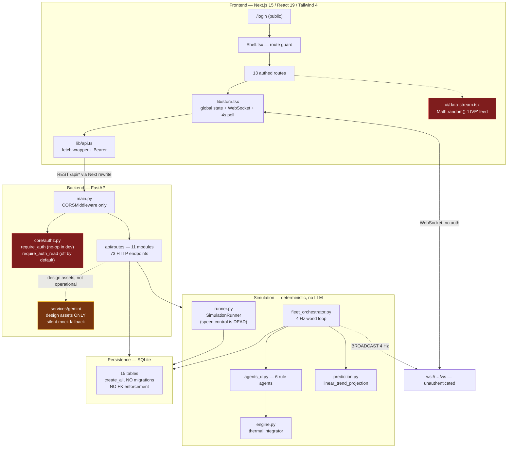

# PROJECT HANDOFF FOR CHATGPT — ColdChain Rescue

**Audit date:** 2026-10-11
**Project root inspected:** `D:\Projects\capstone project\coldchain-platform`
**Git branch:** `chore/token-adoption-codemod` (tracking `origin/chore/token-adoption-codemod`)
**Remote:** `https://github.com/ik123a/coldchain-platform.git`
**HEAD:** `7186005` — `test(e2e): 8-test e2e suite for auth, RBAC and the predictive driver console`
**Audit type:** READ-ONLY. No source file, config file, database, or project setting was modified. This report is the only file created.

---

## 1. Executive summary

ColdChain Rescue is a **CBCA301 capstone project** (Bennett University, BCA Semester V) that presents itself as a *digital twin for cold-chain logistics*: it simulates refrigerated trucks, detects temperature excursions, classifies root causes, and chooses recovery actions (divert / dispatch service truck / transfer cargo).

The single most important thing for an independent reviewer to understand is this:

> **There is no AI model and no machine learning in this project.** The "agents" are deterministic Python `if`/`elif` chains and weighted-sum scoring functions. There is zero LLM inference, zero trained weights, zero vector store, and zero RAG anywhere in the operational path. The word "AI" in this codebase means "a rule engine with good explainability strings".

This is **not** hidden — it is stated explicitly and repeatedly in `README.md:123-130`, `docs/ARCHITECTURE.md:120-127`, and `backend/app/core/config.py:68-73` (`AI_MODE = "DETERMINISTIC-AGENTS"`). That honesty is a genuine engineering strength and should be preserved. The risk is not the code; the risk is that a *reader* of the product (or of the marketing landing page, which contradicts this claim — see §17.1) assumes otherwise.

Three findings dominate everything else:

1. **The authentication layer is largely decorative in the documented default run configuration.** `README.md:75` instructs `$env:APP_ENV="development"`. That makes `IS_DEV` true, which makes `REQUIRE_AUTH` default to `False` (`authz.py:55`), which makes every `require_auth` dependency return `{"sub": "anonymous"}` **without checking the token at all** (`authz.py:87-88`). Following the project's own quick-start yields a fully open API.

2. **A large fraction of the API has no auth dependency whatsoever**, including endpoints that mutate simulation state. `facilities.py`, `shipments.py`, `incidents.py` and `demo.py` all **`import require_auth` and then never use it** — dead imports that read as protection but are not.

3. **A meaningful share of the UI presents fabricated numbers with the visual authority of live telemetry.** The clearest instance is `components/ui/data-stream.tsx`, a `Math.random()` generator rendered under the literal heading **"LIVE TELEMETRY FEED"** on the dashboard (`dashboard/page.tsx:402-404`).

**Runtime verification was not possible.** The ColdChain application is not running on this machine — see §16.2 for a significant discovery about port 8000. Consequently every feature status in §8 is derived from source reading, and is labelled accordingly.

### The four findings that most affect how this project should be judged

1. **The headline "successful recoveries" metric is inflated by construction (H8, §15).** `fleet_orchestrator.py:1242` computes `ok = temperature_in_band or v.box.backup_cooling`, `:1246` sets `resolved = verifier_verdict or ok`, `:1273` writes `RESOLVED`, and `simulation/analytics.py:61-63` counts those rows as `successful_recoveries`. **Switching on backup cooling is sufficient to mark an incident resolved** — the temperature branch is never consulted. This is the number a reviewer or examiner would quote as evidence the agents work.

2. **The documented quick-start yields an open API (H1, §15).** `README.md:75` sets `APP_ENV="development"` → `authz.py:55` → `authz.py:87-88` returns `{"sub":"anonymous"}` **without ever inspecting the token**. Meanwhile `facilities.py`, `shipments.py`, `incidents.py` and `demo.py` **import `require_auth` and never use it**.

3. **A large share of the UI presents fabricated numbers as live telemetry (§10.3, §17.5).** The clearest instance: `components/ui/data-stream.tsx` is a `Math.random()` generator rendered under the literal heading **"LIVE TELEMETRY FEED"** (`dashboard/page.tsx:402-404`). The pattern also reaches the backend — `incidents.py:136` reinstates a hardcoded 2–8 °C band that **contradicts stated design decision D3**.

4. **There is a silent data-loss trap in database path resolution (§12.4).** Because the default SQLite URL is CWD-relative and read before `.env` loads, launching from the wrong directory makes the app **start healthy, report the database as connected, create all 15 tables in the wrong file, and present an empty system** — with no exception and no warning.

---

## 2. Project purpose and intended users

**Stated purpose** (`README.md:5-7`): *"A live operational digital twin for cold-chain logistics: it detects temperature excursions while a vehicle is moving, explains the cause, and drives a verified recovery — rather than reporting the loss after delivery."*

**Intended users**, per `docs/ARCHITECTURE.md` and `HANDOFF.md`: a fleet operations dispatcher (the "operator" role) monitoring refrigerated trucks across Delhi-NCR logistics corridors, and a driver assigned to a specific vehicle.

**Five actors** are claimed in `docs/use-case-diagram.html`. The two with real code paths are **operator** and **driver**; `auth.py:19` allows self-registration as either.

**Assessment:** the problem domain is real and the scope is appropriate for a capstone. The simulation is a legitimate *research/teaching* artefact. What the project is **not** is a production cold-chain system — `README.md:180-181` correctly discloses "Simulation only — no real telematics hardware" and "SQLite, single-node".

---

## 3. Current development status

**Actively developed, feature-complete for its stated scope, with meaningful gaps in hardening.**

Evidence of an active, competent project:
- 40+ conventional commits with clear conventional-commit messages.
- A deterministic acceptance gate (`.loop/judge.py`) written specifically to stop an automated agent from declaring success without evidence (`README.md:154-173`).
- A deliberate anti-Goodhart control (boundary check B1) that byte-compares protected test files to a baseline so tests cannot be edited to make a gate pass.
- A working E2E suite: **8/8 passing** at HEAD.

Evidence that hardening is incomplete:
- The documented quality gate **G1 is currently failing** (§16.1).
- No CI configuration exists in the repository.
- `next.config.mjs:4-5` disables build-time type checking and linting, so type errors ship silently.
- The working tree is dirty, and runtime logs are version-controlled.

**Git working-tree state** (read-only inspection; nothing was changed):

```
 M .run/backend.err.log      (12,667 bytes — tracked, modified)
 M .run/backend.log          (63,115 bytes — tracked, modified)
 M .run/coldchain.pids.json
 M .run/frontend.err.log
 M .run/frontend.log
?? docs/demo/... (6 screenshots, film script, vo2/ voiceover lines, 84s film)
```

**Note:** `.run/*.log` is **tracked in git** and changes on every run, producing permanent diff noise. `.run/` is not in `.gitignore` (`.gitignore:1-54`).

---

## 4. Technology stack and dependency overview

### Frontend — `frontend/package.json`

| Dependency | Version | Role |
|---|---|---|
| `next` | 15.3.2 | App Router |
| `react` / `react-dom` | 19.0.0 | UI |
| `tailwindcss` + `@tailwindcss/postcss` | 4.1.12 | Styling |
| `maplibre-gl` | ^6.9.0 | Map basemap |
| `recharts` | 2.15.3 | Charts |
| `framer-motion` | ^13.2.0 | Animation |
| `lucide-react` | 0.509.0 | Icons |
| `clsx` | 2.1.1 | Class merging |
| dev: `typescript` | 5.8.3 | Type checking |
| dev: `e2e` (`@e2e-dev/web`) | ^0.19.0 | AI-driven browser E2E |

**⚠ Known advisory (documented by the project itself, `README.md:218-221`):** `next@15.3.2` carries **CVE-2025-66478**. The project flags this and recommends upgrading before any public deployment. This is a **Priority 0** item for ChatGPT to weigh.

`tsconfig.json:7` sets `"strict": false`.

### Backend — `backend/requirements.txt` (11 lines, complete)

```
fastapi>=0.110            uvicorn[standard]>=0.27     sqlalchemy[asyncio]>=2.0
aiosqlite>=0.19           pydantic>=2.5               python-jose[cryptography]>=3.3
websockets>=12            reportlab>=4.0              pytest>=8.0
httpx>=0.27               pytest-asyncio>=0.23
```

**Notable:** `python-jose` is marked *"optional; JWT handled stdlib if absent"* — meaning JWT signing is hand-rolled rather than delegated to a library. See §15 (M3) for the security consequence.

**No ML dependency whatsoever.** No `scikit-learn`, `torch`, `tensorflow`, `xgboost`, `prophet`, `numpy`, or `pandas`. There is nothing to fine-tune because nothing is trained.

### Runtime / versions

- Python venv 3.13.9 at `backend/.venv` (`HANDOFF.md:38`).
- Node v26.7.0 observed in the E2E report environment block.
- Windows, `win32 10.0.26300`.

---

## 5. Directory structure and key-file guide

```
coldchain-platform/
├── backend/
│   ├── .env                       ← LOCAL SECRETS (gitignored; never inspected by value)
│   ├── .env.example               ← committable template, no real values
│   ├── requirements.txt
│   ├── coldchain.db               ← LIVE DATABASE, 8,351,744 bytes (gitignored)
│   ├── generate_reference_library.py  ← offline batch image/video generator
│   ├── run_critique_audit.py      ← offline "audit" — see §17.4 (fabricates scores)
│   ├── smoke_run.py
│   └── app/
│       ├── main.py                ← app factory, CORS, startup hook, 12 routers
│       ├── api/routes/            ← 11 route modules, 73 HTTP endpoints
│       ├── core/
│       │   ├── authz.py            ← ONLY 2 auth deps; no require_role exists
│       │   ├── security.py         ← pbkdf2 + hand-rolled HS256 JWT
│       │   └── config.py           ← settings; AI_MODE = DETERMINISTIC-AGENTS
│       ├── database/engine.py      ← engine + get_db; NO pragmas configured
│       ├── models/{entities,fleet}.py ← 15 tables
│       ├── schemas/dto.py          ← pydantic request/response models
│       ├── services/gemini/        ← design-asset AI only; NOT operational
│       ├── simulation/             ← 20 modules: the actual product
│       └── websocket/handler.py    ← /ws broadcast
├── frontend/
│   ├── app/                        ← 14 routes (App Router)
│   ├── components/{live-map,simulation,ops,ui}/
│   ├── lib/{api,auth,store}.tsx    ← data layer, session, global state + WS
│   ├── next.config.mjs             ← /api proxy rewrite; type/lint checks DISABLED
│   └── tests/{auth,driver}.e2e.ts  ← 8 E2E tests, all passing
├── scripts/coldchain.ps1           ← 18 KB launcher/manager (start/stop/rebuild)
├── START.bat / STOP.bat            ← one-click wrappers
├── tools/                          ← rubric_audit, scan_history_secrets, redact_blobs
├── .loop/judge.py                  ← deterministic acceptance gate
├── design-system/                  ← 5 token docs (colors, type, spacing, motion)
├── design-references/              ← 28 PNG + 15 MP4 (offline-generated)
├── docs/                           ← ARCHITECTURE, AUDIT, TESTING, USER-GUIDE, diagrams
├── coldchain.db                    ← ⚠ 0 BYTES — stray artefact, see §12.3
├── README.md, HANDOFF.md
└── PROJECT_HANDOFF_FOR_CHATGPT.md  ← THIS FILE
```

**Files that matter most to a reviewer:**

| File | Why it matters |
|---|---|
| `backend/app/main.py` | The only startup hook; mounts all routers; CORS |
| `backend/app/core/authz.py` | The entire authorization model is 108 lines |
| `backend/app/simulation/fleet_orchestrator.py` | 87 KB — the real product logic |
| `backend/app/simulation/agents_d.py` | The six "agents" — all deterministic |
| `backend/app/simulation/prediction.py` | The "prediction" — one division |
| `backend/app/services/gemini/critique.py` | Contains a **silent mock fallback** |
| `frontend/lib/store.tsx` | Global state, WebSocket, 4 s polling |
| `frontend/app/live-map/page.tsx` | 51 KB / ~1034 lines — largest component |
| `frontend/components/ui/data-stream.tsx` | `Math.random()` behind a "LIVE" label |
| `.loop/judge.py` | The project's own quality gate |

**Missing/empty files of note:** `app/api/__init__.py` and `app/api/routes/__init__.py` are both **0 bytes**; `backend/app/simulation/__init__.py` is 0 bytes. `tools/redact_secrets.txt` is **referenced by `README.md:211` but does not exist** in the repository.

---

## 6. Verified system architecture

### 6.1 Two separate simulation systems

This is the most important architectural fact and the easiest to get wrong.

There are **two independent simulation engines** that share only `engine.py` and `agents_d.py`:

| | **Fleet world** | **Classic runner** |
|---|---|---|
| Owner | `FleetOrchestrator` (`fleet_orchestrator.py:701-779`) | `SimulationRunner` (`runner.py:309-380`) |
| Purpose | The live demo: N trucks on real routes | Single-shipment, single-truck scripted scenarios |
| Clock | `SimClock` (`clock.py:16-43`) — wall-clock × 0.5 × speed | **None.** Fixed `asyncio.sleep(tick_seconds)` |
| Speed control | Fully wired | **Dead** — see §17.2 |
| Termination | Never (endless) | Never |
| Incident ID space | `simulation_id = 0` | `simulation_id = N` |

They write into the **same tables** with a **shared `simulation_id` column** used as the discriminator (`docs/ARCHITECTURE.md:153-163`). This design is documented and deliberate.

### 6.2 Request flow

```
Browser
  │  REST  /api/*      (same-origin → Next rewrite → backend)   frontend/lib/api.ts:8-43
  │                    next.config.mjs:19-22 proxies /api/* → API_ORIGIN (:8000)
  │  WS    ws://…/ws   (direct, NOT proxied)                    frontend/lib/store.tsx:219
  ▼
Next.js dev server (:3000)
  │  rewrite
  ▼
FastAPI (main.py:15)  ── CORSMiddleware only (main.py:18-19)
  │
  ├─ api/routes/*.py  ──► Depends(get_db) ──► SQLAlchemy async ──► SQLite
  │        │
  │        └─► app/simulation/*  ──► FLEET singleton (in-memory world state)
  │
  └─ websocket/handler.py  ◄── BROADCAST (runner.py:27-33), 4 Hz full-fleet snapshots
```

**Key architectural decisions** (`docs/ARCHITECTURE.md:169-182`, independently verified):

- **D2 — `RUNNERS` registry is authoritative over DB rows.** A row saying `RUNNING` is not evidence of a live process; nine phantom runs were found. Status reconciles the two (`status.py:31-33`).
- **The simulation is authoritative; the database is a record** (`docs/ARCHITECTURE.md:66`).

### 6.3 Startup sequence (`main.py:22-53`)

1. `Base.metadata.create_all(engine)` — **no migrations exist** (§12.2).
2. An inline SQLite-only "migration" adding `users.role` and `users.vehicle_id` if absent (`main.py:30-38`), wrapped in `try/except Exception` that logs at **`log.debug`** — near-invisible failures.
3. If `FLEET_AUTOSTART=1`: `asyncio.create_task(FLEET.start(12))` (`main.py:49-51`) — a fire-and-forget task with no handle retained.
4. Default is a **cold world** (`main.py:52-53`).

**There is no shutdown hook.** The fleet loop (`fleet_orchestrator.py:703`, `while True`) and every `asyncio.create_task` are never cancelled on shutdown.

---

## 7. Mermaid architecture diagram



---

## 8. Features and implementation-status matrix

Status key: **VERIFIED** = confirmed in code and consistent with intent · **CODE-ONLY** = confirmed in code but not runtime-verified · **PARTIAL** = implemented but incomplete or inconsistent · **UI-ONLY** = rendered without real backing data · **BROKEN** · **PLANNED**

| # | Feature | Status | Frontend | Backend | Notes |
|---|---|---|---|---|---|
| 1 | Auth: register/login/JWT/`me` | CODE-ONLY | `app/login/page.tsx` | `api/routes/auth.py`, `core/security.py` | pbkdf2 120k + hand-rolled HS256 |
| 2 | Role model (operator/driver) | **PARTIAL** | `Shell.tsx:25-33` | `auth.py:19` | **No `require_role` exists.** Role is registered but never enforced server-side |
| 3 | API authorization on `/api/fleet/*` | **PARTIAL / effectively open** | — | `authz.py:82-99` | No-op when `APP_ENV=development` (the documented default) |
| 4 | Auth on facilities/shipments/incidents/demo | **BROKEN** | — | `facilities.py:5`, `shipments.py:5`, `incidents.py:6`, `demo.py:8` | `require_auth` **imported, never used** |
| 5 | Live fleet map (vehicles, routes, trails) | CODE-ONLY | `app/live-map/page.tsx` (51 KB) | `fleet_orchestrator.py` | DOM/SVG overlay, not MapLibre layers |
| 6 | Incident lifecycle (detect→recover→verify) | CODE-ONLY | `app/incidents/page.tsx` | `fleet_orchestrator.py:831-901` | `simulation_id` splits two ID spaces |
| 7 | Six deterministic agents | CODE-ONLY | `/copilot` | `agents_d.py:31-277` | Rule-based; `ResponsePlannerAgent` is a **literal lookup table** (`agents_d.py:130-173`) |
| 8 | "Prediction" / safe-time-to-critical | **PARTIAL** | `PredictiveSafeTime.tsx` | `prediction.py:70-160` | Self-labels `kinetics_modelled: false`. **Unit bug — see §17.3** |
| 9 | Thermal physics | CODE-ONLY | — | `engine.py:100-165` | Genuine first-order integrator. **Clock mismatch — see §17.3** |
| 10 | Routing / rerouting | PARTIAL | `live-map` | `routing.py:71-110` | Real OSRM call, but **offline in this sandbox**; fallback is a 3-point line |
| 11 | Scenario control (heatwave/rain/fog) | CODE-ONLY | `app/simulation/page.tsx` | `fleet.py` / `traffic.py` | |
| 12 | Human-in-the-loop approvals | CODE-ONLY | `ApprovalQueue.tsx` | `fleet_orchestrator.py:946-1016` | **TS type drift — see §16.1** |
| 13 | Digital twin `/twin` | **PARTIAL** | `app/twin/page.tsx` | `/api/fleet/vehicle/{id}` | Zones B/C/D **hardcoded green** (`twin/page.tsx:18-25`) |
| 14 | Analytics / KPI | CODE-ONLY | `app/analytics/page.tsx` | `api/routes/analytics.py` | `at_risk` **overcounts** (`analytics.py:22-25`) |
| 15 | Reports (JSON/PDF) | CODE-ONLY | `app/reports/page.tsx` | `api/routes/reports.py` | **Unauthenticated** — leaks full incident dossiers |
| 16 | Driver console | CODE-ONLY | `app/driver/page.tsx` | `auth.py:86-132` | E2E-covered |
| 17 | Design-reference image/video gen | CODE-ONLY | *(none)* | `services/gemini/` | **Orphaned** — zero frontend callers |
| 18 | AI design critique | **UI-ONLY / MOCKED** | *(none)* | `critique.py:124-149` | **Silent canned `APPROVED` + 9.4 scores** |
| 19 | Arrhenius kinetics (landing page) | **BROKEN (contradiction)** | `app/page.tsx:144-168` | — | **Contradicts** `prediction.py:131` which says kinetics is NOT modelled |
| 20 | "LIVE TELEMETRY FEED" panel | **UI-ONLY / MOCKED** | `dashboard/page.tsx:404` | — | `Math.random()` generator |
| 21 | "Simulate Relief Offload" button | **UI-ONLY / MOCKED** | `DeepTelemetryDrawer.tsx:86-97` | — | `setInterval` counter; **no API call** |
| 22 | Facility comparison matrix | **BROKEN** | `DeepTelemetryDrawer.tsx:569-601` | `fleet_agents.py` | Clicking any row posts the same action (`live-map:905`) |
| 23 | Command Palette deep-links | **BROKEN** | `CommandPalette.tsx:110-141` | — | Dispatches a non-existent action; query params never read |
| 24 | Nav "Warehouses" / "Replay" filters | **BROKEN** | `Layout.tsx:33,44` | — | Target pages never read the query param |
| 25 | E2E test suite | **VERIFIED PASSING** | `tests/*.e2e.ts` | — | **8/8 passed** at HEAD, 2026-10-11 |

---

## 9. Main user journeys and workflows

### Journey A — Operator monitors and intervenes (the core journey)

1. **Login** → `POST /api/auth/register|login` → `auth.py:14-39` → JWT in `localStorage.cc_token` (`lib/auth.tsx:31-36`).
2. **Shell guard** admits them (`Shell.tsx:25-33`) → `/dashboard`.
3. **`StoreProvider` opens WebSocket** (`store.tsx:219`) *and* starts a 4 s poll of 4 endpoints (`store.tsx:244-251`).
4. **`/live-map`** renders vehicles via a DOM/SVG overlay (`map-overlay.tsx`, `map-markers.tsx`) because **MapLibre's GeoJSON worker does not load in this build** (`map-markers.tsx:43-47`, `map-overlay.tsx:32-40`) — the author documented this and worked around it rather than faking it.
5. **Failure injection** → `POST /api/fleet/vehicle/{id}/inject` (`fleet.py:388`) → `VehicleTwin.inject_failure` (`fleet.py:253-256`).
6. **Detection**: world loop `fleet_orchestrator.py:701` → `_check_incident` (`:831`) → after 6 consecutive ticks → `IC.detect` (`incidents_catalogue.py:164`) → `Incident` row (`:857`) + `AIAnalysis` with **`confidence=1.0` hardcoded** (`:870-876`).
7. **Diagnosis**: `IC.diagnose` (`:882`) → `agents_d.py:52` → weighted constants, "probability" is a **renormalisation of hand-picked numbers** (`agents_d.py:85-90`).
8. **Decision**: `_decide` (`:910`) → `FleetCoordinator.evaluate` (`fleet_agents.py:161`) → weighted scoring → DIVERT if risk improves or ETA gain ≥ 3 min (`fleet_agents.py:212-214`).
9. **Approval**: if `require_approval`, queue + broadcast (`:946-1016`).
10. **Execution**: `resolve_approval` (`:1020`) → `_apply_divert` (`:1174`) → rewrites geometry, resets `done_km = 0` (`:1181`).
11. **Arrival & recycle**: `_check_arrival` (`:1206`) → `_respawn` (`:1298`) puts the truck on a **brand-new random mission**.

### Journey B — Driver claims a truck
Register → `GET /api/auth/available-trucks` (`auth.py:60`) → `POST /api/auth/claim-truck` (`auth.py:86`) → redirected to `/driver`. E2E-covered and passing.

### Journey C — What does NOT work
The AI critique path has **no UI entry point at all** (grep for `/api/gemini` in `frontend/` returns zero hits), and every "Arrhenius kinetics" number on the landing page is a **literal JSX string**.

---

## 10. Frontend and UI/UX findings

### 10.1 Route inventory (14 routes)

All routes except `/login` are behind the client-side guard in `Shell.tsx:21-33`. **There is no `middleware.ts`, no `error.tsx`, no `not-found.tsx`, no `loading.tsx`** — guarding is 100 % client-side, so route protection is not enforced server-side.

> **Notable:** the **marketing landing page `/` is itself behind the auth gate** (`Shell.tsx:26-27`). An anonymous visitor can never see the hero.

| Route | Size | Role gate |
|---|---|---|
| `/login` | 8.5 KB | public |
| `/` | 20 KB | authed |
| `/dashboard` | 21 KB | operator |
| `/live-map` | 51 KB | operator |
| `/incidents` | 21 KB | operator |
| `/simulation` | 16 KB | operator |
| `/driver` | 11 KB | driver |
| `/twin`, `/analytics`, `/copilot`, `/reports`, `/shipments`, `/shipments-live`, `/settings` | 3.8–8 KB | operator |

### 10.2 Confirmed dead controls (16)

| Control | Location | Reason |
|---|---|---|
| Vehicle jump commands | `CommandPalette.tsx:110-114` | Hardcoded `TRUCK-101/104/108/112` fallback with invented temps |
| `dispatch({type:"select_truck"})` | `CommandPalette.tsx:122` | **No such case in the store reducer** (`store.tsx:94-198`) → silent no-op |
| `?truck=` / `?hub=` deep links | `CommandPalette.tsx:123,139` | `live-map` never reads search params |
| Warehouse commands | `CommandPalette.tsx:128-132` | Hardcoded `wh-01/02/03` with fake names/capacities |
| Inject failure via palette | `CommandPalette.tsx:44-45` | Guarded `if (sid)` with no `else` → silently does nothing |
| Nav "Warehouses" | `Layout.tsx:33` | `filter=WAREHOUSES` is not a valid filter **and** is never read |
| Nav "Replay" | `Layout.tsx:44` | `tab=replay` never read |
| Row click → `/live-map?focus=` | `shipments-live/page.tsx:45,57` | `focus` never read |
| Warehouse GeoJSON layer | `dashboard/page.tsx:150-164` | Reads source `"warehouses-src"`, **which is never added** → always `undefined`, dead code |
| Route split-path colours | `live-map/page.tsx:717-718` | CSS `var(--…)` passed as GeoJSON properties; MapLibre's canvas worker **cannot resolve CSS variables** (the file states this itself at `:103-104`) |
| KPI "DELIV" tile | `live-map/page.tsx:269` | Counts `e.text?.includes("delivered")`; fleet events have **no `text` field** → always 0 |
| `activeVideo` state | `app/page.tsx:24` | Setter never called, value never read |
| 6 derived consts | `app/page.tsx:31-38` | Computed, never rendered |
| 6 unused imports | `app/page.tsx:12-17` | `ParticleField`, `ShimmerText`, `StatusBeacon`, `RetroGrid`, `ShineBorder`, `AnimatedBeam` |

### 10.3 Confirmed mock / fabricated UI data

**Highest severity — `components/ui/data-stream.tsx:20-25`** is a `Math.random()` generator rendering strings like ``TRUCK-${Math.floor(Math.random()*900)+100} core_temp=…`` and is displayed at **`dashboard/page.tsx:404`** under the heading **"LIVE TELEMETRY FEED"** with a pulsing LIVE indicator. **A panel explicitly labelled live, showing random data.**

Also fabricated:
- `app/page.tsx:144-246` — Arrhenius "KINETICS BENCHMARK" table, `Ea = 78.4 kJ/mol`, "Est. Loss $145,000", "Saved Value $145,000". All literals. **Directly contradicts** `prediction.py:131` (`kinetics_modelled: false`) and `simulation/page.tsx:233` (*"The projection is a linear trend extrapolation, not a kinetics simulation"*).
- `dashboard/page.tsx:244-258` — telemetry marquee strings (`44.0°C Ambient`, `Warming Rate 2.4x`) not read from state; contradicts the real `fleetMeta.ambient` shown elsewhere.
- `dashboard/page.tsx:283` and `live-map/page.tsx:856` — `<WeatherOverlay condition="heatwave">` **hardcoded**, so the heatwave visual never turns off even when the operator sets weather via a working control.
- `simulation/page.tsx:149-160` — 12 metric tiles with fabricated fallbacks (`4.80°C`, `41.8°C`, `94%`…). **The page looks fully operational with the backend completely disconnected.**
- `simulation/page.tsx:252-265` — the What-If card shows a **real** "STATUS QUO" panel beside a **100 % hardcoded** "AUTONOMOUS DETOUR" panel (`5.2°C`, Risk 14/100, Cargo 100% RESCUED).
- `DeepTelemetryDrawer.tsx` — the single most fabricated component: synthetic `Math.sin` chart (`:54-68`), a fake "Simulate Relief Offload" `setInterval` with no API call (`:86-97`), and hardcoded `$124,000`, `07:42`, `DRV-882`, `94/100`, `GRADE A+`, `108 PSI`, and an 8-stage "MULTI-AGENT STATE PROGRESSION STREAM" that is a **static array** (`:531-539`).
- `twin/page.tsx:18-25` — `if (i !== 0) return i % 2 ? "ok" : "ok"` → **zones B, C and D are permanently green by construction**.

### 10.4 Genuinely good frontend work

Credit where due — these are real quality signals:
- **Route guard + RBAC redirect** (`Shell.tsx:25-33`), E2E-covered.
- **Session handling**: global 401/403 interceptor (`api.ts:21-28`), optimistic cache + `/me` confirmation (`auth.tsx:165-183`), clean logout.
- **`prefers-reduced-motion` honoured globally** (`globals.css:185-192`, `ops.css:232-243`) — acknowledged in `docs/ARCHITECTURE.md:182` as decision D10 ("156 infinite animations with zero accommodation").
- **Touch-target floor** enforced in CSS (`globals.css:203-221`).
- **Real design-token system**: `:root` + `[data-theme=light]` custom properties; ~130 `var()` uses. (But ~121 hardcoded hex literals remain — §18.)
- **ARIA** is used genuinely: `aria-current` on nav, `role="dialog" aria-modal` on the palette, `role="log"`, `aria-expanded`, keyboard handlers on incident rows.
- **Clean MapLibre workaround**: rather than faking map rendering, the author diagnosed the missing GeoJSON worker and built a projected DOM/SVG overlay with per-frame `map.project()`.

### 10.5 Accessibility & responsive gaps

- **No mobile navigation.** The sidebar collapse toggle is `md:grid` (`Layout.tsx:113`), i.e. hidden below `md`. On a phone the 232 px sidebar cannot be collapsed and there is no drawer.
- **No focus management.** No focus trap in the command palette, no Escape handler on the two large drawers, no focus restoration on modal close.
- **Clickable `<tr>` without `tabIndex`/`role`** — `FleetTable.tsx:93`, `shipments/page.tsx:34`, `shipments-live/page.tsx:57` are keyboard-inaccessible.
- **Missing labels** on some inputs (`shipments/page.tsx:22`).

### 10.6 Performance

- `live-map/page.tsx` is a **51 KB / ~1034-line single client component**.
- `map-overlay.tsx:83-157` runs an **unconditional rAF loop that never parks**, projecting and rewriting every route polyline point **every frame forever**, even when idle. The rAF in `live-map:639-682` by contrast parks correctly — the two are inconsistent.
- `dashboard/page.tsx:280` — `ParticleField` with `connected` runs O(n²) distance maths per frame at 60 fps.
- **No `React.memo` anywhere.**
- `store.tsx:244-251` polls 4 endpoints every 4 s **on every route**, including `/settings`, with no route-awareness and no `document.visibilityState` pause.
- `map-markers.tsx:62-101,77` — the rAF calls `setProjected(next)`, triggering a **full React re-render per animation frame** during any camera move (`flyTo`/`easeTo` ≈ 60 renders/s), rendering a `<button>` per point (`:109-175`).
- `map-overlay.tsx:83-157` duplicates work the (dead) MapLibre layer path already does, and **never parks** — `requestAnimationFrame` is re-armed unconditionally at both `:84` and `:159`.
- `dashboard/page.tsx:167-174` — `map.easeTo({duration:900})` re-fires on **every** `vehicles` change, i.e. every 4 s poll, while tracking.
- `live-map/page.tsx:567-598` — a theme change calls `map.setStyle()`, destroying and rebuilding every source/layer/tile, with no guard against rapid toggling.
- `live-map/page.tsx:826-981` — ~155 lines of JSX rebuilt on every store tick.
- **No dynamic imports** — `maplibre-gl`, `recharts`, `framer-motion`, and `lucide-react` load on nearly every route (`live-map:3`, `dashboard:6` import maplibre-gl unconditionally).

### 10.7 Second-pass frontend findings

| Finding | Location | Why it matters |
|---|---|---|
| **Likely permanently-broken prediction panel.** `DeepTelemetryDrawer.tsx:174-175` reads `vehicle.prediction` and `vehicle.lessons`, but the `VSnap` interface (`live-map:177-187`) declares **neither field**. | `DeepTelemetryDrawer.tsx:174-175` | If the fleet payload omits them, `PredictiveSafeTime` renders *"No projection available for this vehicle."* (`:133-138`) **forever** — a prominent feature that silently never works. **The single most valuable thing to check at runtime.** |
| **Report download links cannot authenticate.** `reports/page.tsx:89-90` and `incidents/page.tsx:311-312` use plain `<a href="/api/reports/...">`, which **cannot attach an `Authorization` header**. | both | Directly collides with H7 remediation: **if `require_auth` is applied to `/api/reports/*`, all 8 download anchors will 401.** Fixing the security finding breaks these links unless they are converted to authenticated `fetch` + blob download |
| **14 × `.catch(() => {})`** — `shipments:12`, `analytics:22-23`, `live-map:428,503,703`, `copilot`, `twin`, `dashboard:90`, `FleetRiskBanner:60` | frontend-wide | **A dead backend renders as a clean, empty, healthy-looking dashboard** rather than an error. Failure is indistinguishable from "no data" on most routes |
| **`/dashboard` has no loading, empty, or error state** | `dashboard/page.tsx` | `MetricChip:442` renders `—`; the page flashes `0` before real data arrives |
| **`/twin` is the least-covered page** — all three states missing; stale data renders as healthy green zones | `twin/page.tsx` | Compounds the always-green zones bug (§10.3) |
| **No `:focus-visible` ring anywhere.** `globals.css:328-329` sets `outline: none` on `input, select` and compensates with `border-color` only. | `globals.css:328-329` | **A real keyboard-accessibility defect**, not a style preference — keyboard users get no visible focus indicator on form controls |
| **Overlays are not announced as dialogs.** `DeepTelemetryDrawer:100-105` and `PlaybackModal` (`incidents:36-37`) lack `role="dialog"`, `aria-modal`, and an accessible name. | both | Screen-reader users are not told a modal opened |
| **The Digital Twin page is entirely theme-blind** — ~15 literal hex in `twin/page.tsx:41-101` | `twin/page.tsx` | Does not respond to `[data-theme="light"]` at all, unlike the rest of the app |
| **`NumberTicker` writes `ref.current.textContent`** every spring frame | `number-ticker.tsx:62` | Bypasses React and emits no assistive-technology change events |
| **~350 lines of unused animation library** | `components/ui/` | `AnimatedBeam` (183 L — imported by `app/page.tsx:17` and never used), `RetroGrid`, `ShineBorder`, `WeatherOverlay`, `ShimmerText` |
| **6 duplicate component pairs** | frontend-wide | `AnimatedNumber.tsx` (27 L) vs `ui/number-ticker.tsx` (81 L); `RiskGauge.tsx` (29 L) vs `ui/animated-gauge.tsx` (179 L); two overlay systems (NotificationCentre + CommandPalette); two nav sources (`Layout.tsx:17-53` + `CommandPalette.tsx:74-105`) |

---

## 11. Backend and API inventory

**Totals: 73 HTTP endpoints + 1 WebSocket = 74 route decorators**, enumerated by regex and reconciled against a full read of every route file.

> **Structural note:** all 12 `include_router` calls at `main.py:56-67` are **bare** — none passes a `prefix=`. Every prefix comes from the `APIRouter(prefix=...)` inside each module.

### 11.1 Authorization model — read this first

`core/authz.py` defines **exactly two** dependencies.

**There is no `require_role` function anywhere in the backend** — a repo-wide grep returns zero matches. **No endpoint is role-gated.**

| Dependency | Line | Default behaviour |
|---|---|---|
| `require_auth` | `authz.py:82-99` | `REQUIRE_AUTH = _flag("REQUIRE_AUTH", not IS_DEV)` (`:55`). **When false, returns `{"sub":"anonymous","mode":"dev-open"}` without validating anything** (`:87-88`). |
| `require_auth_read` | `authz.py:102-108` | `REQUIRE_AUTH_READS = _flag(..., False)` — **inert by default** (`:106-107`). |

`IS_DEV` is true when `APP_ENV`/`ENV` ∈ {dev, development, local, test} or `DEV` is set (`authz.py:42-43`). **`README.md:75` tells the user to set `APP_ENV="development"`.**

### 11.2 Endpoint table

Auth column: **PUB**=public · **RA**=`require_auth` · **RAR**=`require_auth_read` (off by default) · **MAN**=manual inline `Header` check · **NONE**=no auth of any kind

| # | Method | Path | Purpose | Auth | File:line |
|---|---|---|---|---|---|
| 1 | GET | `/` | Banner, mode, doc links | NONE | `main.py:70` |
| 2 | POST | `/api/auth/register` | Create user + JWT | PUB | `auth.py:14` |
| 3 | POST | `/api/auth/login` | Credentials → JWT | PUB | `auth.py:32` |
| 4 | GET | `/api/auth/me` | Current profile | MAN | `auth.py:42` |
| 5 | GET | `/api/auth/available-trucks` | Assignable trucks | MAN | `auth.py:60` |
| 6 | POST | `/api/auth/claim-truck` | Bind driver → vehicle | MAN | `auth.py:86` |
| 7 | POST | `/api/auth/unassign-truck` | Release vehicle | MAN | `auth.py:119` |
| 8 | GET | `/api/status` | Health rollup | **NONE** | `status.py:14` |
| 9 | POST | `/api/demo/base` | Seed facilities/zones/shipments | **NONE** | `demo.py:54` |
| 10 | POST | `/api/demo/launch` | Seed + create + start sim, inject failure | **NONE** | `demo.py:65` |
| 11 | GET | `/api/facilities` | List facilities | **NONE** | `facilities.py:12` |
| 12 | GET | `/api/facilities/{fid}` | One facility | **NONE** | `facilities.py:18` |
| 13 | GET | `/api/zones` | List zones | **NONE** | `facilities.py:25` |
| 14 | POST | `/api/zones` | **Create zone (write)** | **NONE** | `facilities.py:33` |
| 15 | GET | `/api/shipments` | List shipments | **NONE** | `shipments.py:12` |
| 16 | POST | `/api/shipments` | **Create shipment (write)** | **NONE** | `shipments.py:20` |
| 17 | GET | `/api/shipments/{sid}` | One shipment | **NONE** | `shipments.py:27` |
| 18 | GET | `/api/dashboard` | Dashboard rollup | **NONE** | `analytics.py:13` |
| 19 | GET | `/api/analytics` | Incident KPIs | **NONE** | `analytics.py:51` |
| 20 | POST | `/api/simulations` | **Create sim** | **NONE** | `simulations.py:31` |
| 21 | GET | `/api/simulations/{id}` | Live snapshot | **NONE** | `simulations.py:59` |
| 22 | POST | `/api/simulations/{id}/start` | **Control** | **NONE** | `simulations.py:69` |
| 23 | POST | `/api/simulations/{id}/pause` | **Control** | **NONE** | `simulations.py:78` |
| 24 | POST | `/api/simulations/{id}/reset` | **Control: destroys + recreates runner** | **NONE** | `simulations.py:87` |
| 25 | POST | `/api/simulations/{id}/speed` | Set speed | RA | `simulations.py:98` |
| 26 | POST | `/api/simulations/{id}/failure/{cause}` | Inject failure | RA | `simulations.py:113` |
| 27 | POST | `/api/simulations/{id}/action` | Execute recovery action | RA | `simulations.py:118` |
| 28 | GET | `/api/incidents` | List incidents | **NONE** | `incidents.py:16` |
| 29 | GET | `/api/incidents/{iid}` | Incident + actions + analyses | **NONE** | `incidents.py:39` |
| 30 | POST | `/api/incidents/{iid}/action` | **Executes a real recovery action** | **NONE** | `incidents.py:55` |
| 31 | POST | `/api/incidents/{iid}/what-if` | Project N ticks (unbounded) | **NONE** | `incidents.py:71` |
| 32 | POST | `/api/incidents/{iid}/ask-ai` | Keyword-matched canned text — **not an LLM** | **NONE** | `incidents.py:119` |
| 33 | GET | `/api/reports/{iid}.json` | **Full incident dossier download** | **NONE** | `reports.py:87` |
| 34 | GET | `/api/reports/{iid}.pdf` | **Same, as PDF** | **NONE** | `reports.py:97` |
| 35 | GET | `/api/fleet/dispatch` | Trucks + catalogue | RAR | `fleet.py:95` |
| 36 | POST | `/api/fleet/dispatch` | Bulk replace trucks | RA | `fleet.py:124` |
| 37 | POST | `/api/fleet/dispatch/trucks` | Add truck | RA | `fleet.py:137` |
| 38 | PATCH | `/api/fleet/dispatch/trucks/{tid}` | Configure truck | RA | `fleet.py:151` |
| 39 | POST | `/api/fleet/dispatch/trucks/{tid}/start` | Start truck | RA | `fleet.py:162` |
| 40 | DELETE | `/api/fleet/dispatch/trucks/{tid}` | Remove truck | RA | `fleet.py:171` |
| 41 | POST | `/api/fleet/dispatch/start` | Spawn trucks | RA | `fleet.py:181` |
| 42 | POST | `/api/fleet/dispatch/clear` | Tear down fleet | RA | `fleet.py:190` |
| 43 | GET | `/api/fleet/scenarios` | Runs 6 scenarios **synchronously in the event loop** | RAR | `fleet.py:201` |
| 44 | GET | `/api/fleet/predictions` | Safe-time projections | RAR | `fleet.py:225` |
| 45 | GET | `/api/fleet/incidents/{iid}/diagnosis` | Ranked causes | RAR | `fleet.py:250` |
| 46 | GET | `/api/fleet/incidents/catalogue` | Detectable types + known gaps | RAR | `fleet.py:285` |
| 47 | GET | `/api/fleet/approvals` | Pending + history | RAR | `fleet.py:303` |
| 48 | POST | `/api/fleet/approvals/mode` | Toggle HITL gate | RA | `fleet.py:325` |
| 49 | POST | `/api/fleet/approvals/{key:path}` | Approve/reject | RA | `fleet.py:344` |
| 50 | GET | `/api/fleet/state` | Full live fleet state | RAR | `fleet.py:359` |
| 51 | GET | `/api/fleet/warehouses` | Warehouse list | RAR | `fleet.py:364` |
| 52 | GET | `/api/fleet/vehicle/{vid}` | Vehicle detail | RAR | `fleet.py:369` |
| 53 | GET | `/api/fleet/vehicle/{vid}/history` | Telemetry history | RAR | `fleet.py:377` |
| 54 | POST | `/api/fleet/vehicle/{vid}/inject` | **Force failure** | RA | `fleet.py:388` |
| 55 | POST | `/api/fleet/vehicle/{vid}/action` | **Apply action** | RA | `fleet.py:393` |
| 56 | POST | `/api/fleet/inject-random` | **Inject failure** | RA | `fleet.py:398` |
| 57 | POST | `/api/fleet/speed` | Set global speed | RA | `fleet.py:403` |
| 58 | POST | `/api/fleet/weather` | Force weather | RA | `fleet.py:408` |
| 59 | POST | `/api/fleet/pause` | Toggle pause | RA | `fleet.py:414` |
| 60 | POST | `/api/fleet/resume` | Resume | RA | `fleet.py:419` |
| 61 | POST | `/api/fleet/demo` | One-click rescue | RA | `fleet.py:426` |
| 62 | GET | `/api/fleet/route-compare/{vid}` | Route options | RAR | `fleet.py:436` |
| 63 | POST | `/api/fleet/service/dispatch` | Dispatch service truck | RA | `fleet.py:447` |
| 64 | POST | `/api/fleet/transfer` | Cargo transfer | RA | `fleet.py:455` |
| 65 | GET | `/api/fleet/replay/{iid}` | Frame replay | RAR | `fleet.py:466` |
| 66 | POST | `/api/fleet/rebuild` | Stop → rebuild → start | RA | `fleet.py:475` |
| 67 | GET | `/api/fleet/analytics` | Live KPIs | RAR | `fleet.py:485` |
| 68 | GET | `/api/fleet/priority-queue` | By time-to-critical | RAR | `fleet.py:491` |
| 69 | GET | `/api/gemini/references` | Asset catalogue (**hardcoded scores**) | **NONE** | `gemini.py:39` |
| 70 | POST | `/api/gemini/generate-image` | **Billable call** | **NONE** | `gemini.py:45` |
| 71 | POST | `/api/gemini/generate-video` | **Billable call** | **NONE** | `gemini.py:57` |
| 72 | GET | `/api/gemini/video-status/{op}` | Poll operation | **NONE** | `gemini.py:70` |
| 73 | POST | `/api/gemini/critique` | **Billable call** | **NONE** | `gemini.py:76` |
| 74 | WS | `/ws` | Full telemetry broadcast | **NONE** | `websocket/handler.py:9` |

### 11.3 Error handling

- `HTTPException` is used consistently for *expected* failures (409/401/403/404).
- **There is no global exception handler.** A grep for `exception_handler`/`add_exception_handler` returns zero matches.
- `get_db` (`database/engine.py:17-19`) has **no `try/except`/`rollback`** — any SQLAlchemy error becomes an opaque 500.
- `reportlab` is imported *inside* the handler (`reports.py:103-107`) — a missing dependency yields 500, not a clean error.
- **`gemini.py:4` imports `HTTPException` and `BackgroundTasks`; neither is used.** No status mapping exists for any Gemini failure.
- **Errors returned as success:** `image_generation.py:34-36` and `:127` return `{"success": false}` with **HTTP 200**.
- **`status.py:36` hardcodes `"websocket": "CONNECTED"`** — the field never probes anything and is structurally incapable of reporting a fault.
- **`status.py:31-33`: a `GET` endpoint mutates the database**, reconciling orphaned `Simulation` rows.
- `incidents.py:16-22` filters status/severity **in Python after `.limit()`**, so filtered results can be silently incomplete.

---

## 12. Database schema and data flows

### 12.1 Technology

SQLAlchemy 2.0 async + `aiosqlite`. `create_async_engine(DATABASE_URL, echo=..., pool_pre_ping=True)` (`engine.py:9`). Session via `async with SessionLocal()` (`engine.py:17-19`). **24 `commit()` call sites. Zero `rollback()`. Zero `flush()`.**

### 12.2 Schema — 15 tables

`entities.py` (10): `users`, `facilities`, `zones`, `shipments`, `simulations`, `sensor_readings`, `incidents`, `ai_analyses`, `recommended_actions`, `alerts`
`fleet.py` (5): `fleet_vehicles`, `fleet_routes`, `fleet_vehicle_events`, `fleet_route_decisions`, `fleet_cargo_transfers`

**There are ZERO `relationship()` declarations anywhere.** All "relationships" are FK columns with no ORM navigation.

**No migrations.** Schema comes from `Base.metadata.create_all` (`main.py:24-25`) plus a 6-line inline SQLite-only `ALTER TABLE` shim (`main.py:30-38`) wrapped in a `log.debug`-level `except`.

**No SQLite pragmas are configured.** A grep for `PRAGMA|journal_mode|busy_timeout|connect_args|listens_for` across `backend/` returns exactly one hit — `PRAGMA table_info(users)` at `main.py:32`, which is *introspection*, not configuration. Consequences:
- **No WAL** → readers block writers.
- **No `busy_timeout` is set in application code** — but the live database reports `busy_timeout = 5000` ms (§16.5). That value comes from **Python's `sqlite3` default `timeout=5.0`, not from this project.** The practical effect is that a contended write waits up to 5 s before raising, so M13's "locks immediately" framing is **overstated**; the swallowed-write-failure risk in M13 is still real, but the trigger is a >5 s stall, not an instant collision.
- **No `foreign_keys=ON`** → **every declared `ForeignKey` in this schema is unenforced at runtime.** SQLite defaults FK enforcement OFF per connection.

**Every default is a Python-side `default=`. There is not a single `server_default=` in the codebase**, so emitted DDL contains no `DEFAULT` clauses.

**Integrity gaps:**
- `fleet_vehicle_events.vehicle_id`, `fleet_route_decisions.vehicle_id`, `fleet_cargo_transfers.vehicle_id` are `index=True` but **NOT ForeignKeys** (`fleet.py:50,63,75`).
- `fleet_cargo_transfers.facility_id` is `String(12)` while `facilities.id` is `Integer` — a **type mismatch** (`fleet.py:76`).
- `fleet_vehicles.shipment_id` is `String(12)` vs `shipments.id` `Integer` — soft link, not a FK (`fleet.py:25`).
- `users.vehicle_id` is a plain `String(40)`, **not** a FK to `fleet_vehicles.id` (`entities.py:19`).
- **`Alert.severity` defaults to the literal string `"COPY"`** (`entities.py:135`) while the same line's comment declares the legal domain `# INFO/WARNING/CRITICAL`. **`"COPY"` is not a member of that domain.** *(I verified this line directly.)* All current callers pass severity explicitly, so this is latent rather than actively producing bad rows — but it is a live trap and a symptom of the deeper problem: **every "enum" (`status`, `severity`, `priority`, `role`, `decision`) is an unconstrained free-text `String` with no `CheckConstraint` or `Enum`.**
- Missing indexes on the most-filtered columns: `incidents.status` (filtered at `status.py:34`, `analytics.py:16,63`) and `zones.facility_id`.

### 12.3 The two database files

| File | Size | Assessment |
|---|---|---|
| `backend/coldchain.db` | **8,351,744 bytes** | The live database |
| `coldchain.db` (repo root) | **0 bytes** | **Stray artefact** |

**Mechanism (INFERRED, high confidence):** `engine.py:7` reads `DATABASE_URL` **at module import time**, defaulting to `sqlite+aiosqlite:///./coldchain.db` — a **CWD-relative** path. `.env` is loaded only when `core/config.py` is first imported (`config.py:20-26`). `main.py:6` imports config *before* `main.py:7` imports engine, so the documented `cd backend` path works. But `engine.py` does **not** import `config.py`, and several modules (`runner.py:10`, `fleet_orchestrator.py:23`) import `database.engine` directly. **Any entry point that touches the engine before config silently falls back to the CWD-relative default** — creating or opening a 0-byte file in whatever directory it was launched from. A 0-byte file means a connection was opened and nothing was ever committed.

**Supporting detail:** the three-dot-slash form resolves against the **process working directory**, and there is **no `os.path.dirname(__file__)` anchoring anywhere in `engine.py`**. A SQLite file that had ever had `create_all` run against it (15 `CREATE TABLE`s) would be ≥ 4 KB; **exactly 0 bytes with created == modified proves a connection opened and closed with no committed write.** The root file's timestamp is consistent with a one-off tooling or install process running with CWD = project root.

### 12.4 The silent data-loss trap (highest operational risk in the persistence layer)

This is the practical consequence of §12.3, and it is worse than "a stray file":

> **If the server is ever launched from the project root *and* `.env` fails to load, the application comes up healthy, reports `"database": "CONNECTED"` — and writes all 15 tables into the wrong file, presenting a completely empty system.**

Why it fails silently rather than loudly:
- `config.py:27-36` explicitly **tolerates a missing `python-dotenv`**, so a missing dependency is not an error.
- `status.py:17-19` reports database health by running `SELECT 1` only — it **never verifies it opened the intended file.**
- `main.py:24-25` `create_all` happily creates 15 tables in whatever file the engine opened.
- The failure mode is an **empty file, not an exception** — so nothing raises.

**No code path would ever mention the root file exists.** An operator would see a working app, an empty dashboard, and a green health check. Every documented launch path does `cd backend` first (`README.md:74-77`, `HANDOFF.md:36`, `docs/USER-GUIDE.md:153` — *"**Critical:** you must cd backend first"*), but nothing *enforces* it.

**Remediation:** anchor the default to `Path(__file__).resolve().parents[2] / "coldchain.db"` so the path is independent of CWD, and make `status.py` verify the resolved path rather than just `SELECT 1`. This is listed as **P1-10** in §20.

### 12.5 Data flow

Simulation state lives **in memory** in the `FLEET` singleton; the database is a record, not the source of truth (`docs/ARCHITECTURE.md:66`). Writes happen from inside the 4 Hz loop: `_evt()` opens a session and commits **per event** (`fleet_orchestrator.py:1443-1454`), and `_persist_vehicles` runs an **N+1 query pattern** — one `s.get(Vehicle, vid)` per vehicle, every 20 ticks (`:1456-1479`), with errors swallowed by `log.warning("persist failed")`.

---

## 13. AI / ML / agentic AI architecture

### 13.1 Bottom line

> **No LLM, no ML model, no trained weights, no vector store, no embeddings, no RAG, no inference of any kind participates in any operational decision.**

Verified by a full import sweep of `backend/app/simulation/`: zero references to `gemini`, `openai`, `anthropic`, `google-genai`, `sklearn`, `torch`, `tensorflow`, `xgboost`, or `prophet`. The **only** outbound network call in the entire simulation package is OSRM road routing (`routing.py:73`).

`core/config.py:68-73` states this plainly (`AI_MODE = "DETERMINISTIC-AGENTS"`), and `fleet_agents.py:4` says *"No LLM needed"*.

### 13.2 The six "agents" — all deterministic

| Agent | File:line | Verdict |
|---|---|---|
| `MonitoringAgent` | `agents_d.py:31-46` | Passthrough + 2 `if` statements |
| `DiagnosisAgent` | `agents_d.py:49-94` | 7 **hand-picked constants** (0.62, 0.72, 0.93…). "Probability" is a renormalisation of those constants — **not a measured probability** |
| `RiskAnalystAgent` | `agents_d.py:97-121` | Additive weighted sum + linear extrapolation |
| `ResponsePlannerAgent` | `agents_d.py:124-178` | **A literal `plans = {...}` lookup table** (`:130-173`) mapping cause → pre-written action dicts with canned `reason`/`expected_effect` strings. **This is a `switch` statement wearing an agent class** |
| `RecoveryVerifierAgent` | `agents_d.py:181-205` | Boolean expression; the `or in_range and compressor_path` clause is very permissive |
| `ReporterAgent` | `agents_d.py:208-277` | Arithmetic over 5 terms + an f-string template |

Plus three fleet-side helpers: `FacilityMatcher` (`fleet_agents.py:19-69`), `RouteScorer` (`:118-150`), `FleetCoordinator` (`:153-230`) — all weighted-sum heuristics with declared `WEIGHTS` (`:79-81`).

**No agent learns anything.** There is no training loop, no feedback weight update, and no memory beyond a fixed constant table.

### 13.3 The Gemini integration — real, but orphaned, and mock-shaped

Four genuine HTTPS calls to `generativelanguage.googleapis.com` exist (raw `requests`, **no SDK**). Verdicts:

| Call site | File:line | Verdict |
|---|---|---|
| `critique_reference_asset` (network path) | `critique.py:99-118` | **REAL CALL** with a mock-shaped fallback |
| `critique_reference_asset` (missing key) | `critique.py:35-36` | **FALLBACK-ONLY** — silent canned `APPROVED` |
| `critique_reference_asset` (error/timeout) | `critique.py:120-121` | **FALLBACK-ONLY** — silent canned `APPROVED` |
| `get_all_references` | `assets.py:9-51` | **MOCKED** — pure static dict, no network call at all |
| `generate_reference_image` | `image_generation.py:41,87` | **REAL CALL**, honest failure |
| `generate_reference_video` | `video_generation.py:74` | **REAL CALL** (submit only; never completes) |
| `check_video_operation` | `video_generation.py:103` | **REAL CALL**, honest failure |
| All `/api/gemini/*` **from the product UI** | — | **UNUSED — zero frontend callers** |

**The silent mock (`critique.py:124-149`)** returns hardcoded scores — `visual_quality: 9.4`, `information_hierarchy: 9.6`, `simplicity: 9.2`, `originality: 8.9`, `logistics_fit: 9.8`, `ai_slop_risk: 1.4`, `motion_quality: 9.1` — with `overall_verdict: "APPROVED"` and the summary *"zero AI slop, ready for enterprise deployment."* **Nothing in the response marks it as synthetic**, so a caller cannot distinguish a real critique from a mock. This triggers on: missing key, timeout, provider 4xx/5xx, **and even a malformed-but-successful response** (the `json.loads` sits inside the `try`, so it is swallowed at `:117`).

**The catalog the UI can actually see is worse:** `assets.py:22-24` stamps `status: "APPROVED"`, `critique_score: 9.4`, `ai_slop_score: 1.2` on **all 28 images**, with **no model call anywhere in the code path**. Videos get a third, different constant set (`:40-42`).

> **Consequence for the reviewer: every "APPROVED", `9.4`, and `1.2` score in this project is a fabricated literal, not an evaluation.**

### 13.4 Prediction — honest about itself, but has a unit bug

`prediction.py:70-160` is a subtraction and a division. It self-labels `model: "linear_trend_projection"` and `kinetics_modelled: False` (`:131-132`). **This honesty is a strength and should be preserved** — it is directly contradicted by the landing page (§17.1).

However `prediction.py:94` consumes `cargo.trend_c_per_min`, which is **not scaled to per-minute** while `prediction.py:117` divides by it as if it were. See §17.3.

### 13.5 Human-in-the-loop controls

Genuinely present and genuinely wired: `require_approval` (default `True`, `fleet_orchestrator.py:83`), approval queue with escalate-after-N, approve/reject endpoints, and an escalation broadcast. **This is the most defensible "agentic" claim in the project.**

### 13.6 Cost, latency, safety

- **No `maxOutputTokens` anywhere.** No caching. No usage/cost logging.
- **All four Gemini services are synchronous `requests` called from `async def` handlers** (`gemini.py:48,60,73,79`) with no `asyncio.to_thread` — **blocking the entire event loop** for up to 45 s × 3 keys = **135 s** for one image request.
- **The API key is placed in the URL query string** (`?key=…`), landing in proxy/access logs.
- **Unauthenticated arbitrary-prompt relay** — `gemini.py:18,25` accept free-form client prompts forwarded verbatim to Google at the operator's expense.
- **Prompt injection:** `critique.py:66` interpolates client-supplied `asset_id` into a JSON skeleton; an embedded quote breaks the structure. The "system" prompt is concatenated as a **user turn** (`critique.py:103`), defeating role separation.
- **Arbitrary local file read + exfiltration:** `image_generation.py:47-60` reads `Path(ref_path)` from an **unvalidated client-supplied `reference_images` list** and base64-uploads it to Google. Unauthenticated.
- **Positive:** no shipment, customer, driver, or telemetry data is ever automatically placed into a prompt. PII leakage to the provider is operator-initiated only.

### 13.7 Orchestration reality — there is no orchestrator, and no scheduler

The word "orchestrator" appears in module names (`fleet_orchestrator.py`) but a second-pass review established three facts that materially qualify the "multi-agent" framing:

1. **There is no scheduler, job queue, or worker anywhere in the backend.** A repo-wide grep for `apscheduler|BackgroundScheduler|cron|AsyncIOScheduler|threading|Timer(` returns **zero matches**. No Celery, no queue, no thread pool. All background work is either a FastAPI startup task (`main.py:50`) or a detached `asyncio.create_task` — e.g. the AI decision at `fleet_orchestrator.py:899` and cargo transfer at `:1386`, both fire-and-forget with no handle retained and no failure callback.

2. **There is no inter-agent coordination, and this is a live capacity bug.** `FleetCoordinator.evaluate` (`fleet_agents.py:161-230`) runs **per incidented vehicle in isolation**, with no awareness of other vehicles' decisions. Nothing arbitrates contention: **two trucks can be diverted to the same facility simultaneously.** Only single-threaded event-loop serialisation stands between them, and `facility_id` is `String(12)` while `facilities.id` is `Integer` with no FK (§12.2), so nothing detects the collision.

3. **An unattended demo deadlocks silently at the approval gate.** `_expire_approvals` (`fleet_orchestrator.py:1078-1089`) is governed by `AUTO_APPROVE_TIMEOUT_SIM_MIN` (`:87-88`), which **defaults to `0` = disabled**. Combined with `require_approval` defaulting to `True` (`:83`), an unattended run with no operator leaves recommendations pending **indefinitely** — the simulation simply stops progressing with no user-visible error. This is a deliberate design choice (the human gate is the point), but it means the demo cannot be left running unattended, and nothing in the UI reports the stall.

**Summary:** the *agents* are real and deterministic; the *orchestration* is a single-threaded `while True` loop that happens to call them in sequence. There is no planning layer, no multi-agent negotiation, and no scheduling.

---

## 14. External services and integrations

| Service | Used for | Runtime path? | Auth | Notes |
|---|---|---|---|---|
| **OpenStreetMap / OSRM** | Real road geometry | **YES** | none | `routing.py:71-84`. **Unreachable in this sandbox**; cache latches off permanently after first failure (`:61`). Fallback is a **3-point line** (`:98-103`) |
| **Google Gemini** (REST, raw `requests`) | Design-reference images/videos, design critique | **NO** | API key in URL | Orphaned — zero UI callers. Model IDs `gemini-3.8-flash`, `gemini-3.1-flash-image`, `veo-3.1-generate-preview` **do not match Google's published identifiers**; if they are not valid, every call 404s into its fallback |
| **MapLibre GL / Esri basemap tiles** | Map rendering | YES | none | Basemap only; the GeoJSON worker does not load (§10.4) |
| `reportlab` | PDF export | YES | — | Imported inside the handler (`reports.py:103`) |
| Gemini TTS | Demo narration | build-time only | — | `docs/demo/make_narration.py` |

**Configuration note:** `config.py:56-64` declares `GEMINI_API_KEY_PRIMARY`, `GEMINI_KEYS`, model names, etc., but **the Gemini services never import `core.config`** — they read `os.getenv` directly at module scope. The config module is decorative for this purpose.

---

## 15. Security and reliability findings

Severity-ranked. **VERIFIED** = read directly in the cited source. No speculative issues are listed as confirmed.

### CRITICAL

**C1 — Unauthenticated arbitrary local file read, exfiltrated to a third party.**
`gemini.py:45` (`/api/gemini/generate-image`) has **no auth dependency**. `image_generation.py:47-60` iterates the client-supplied `reference_images` list, checks only `Path(p).exists()`, and base64-uploads the file contents to Google. No path containment, no extension allowlist, no size limit. Any reachable client can cause the server to read and transmit **any file the process can read** — including `backend/.env` (which holds a live `GEMINI_API_KEY`). *Consequence: credential and data exfiltration to an external provider. The file contents are not returned directly to the caller in the success path; they are uploaded to Google.* Same pattern at `video_generation.py:49-59`.

**C2 — Unauthenticated, unmetered endpoints that spend money.**
All five `/api/gemini/*` routes (`gemini.py:39-85`) lack any auth dependency, rate limit, or quota cap. Compare `demo.py:93`, which does use `Depends(require_auth)`. Free-form client prompts are forwarded verbatim to a paid API.

### HIGH

**H1 — The operational API is effectively unauthenticated on the documented default run configuration.** VERIFIED directly: `README.md:75` sets `APP_ENV="development"` → `authz.py:43` `IS_DEV=True` → `authz.py:55` `REQUIRE_AUTH=False` → `authz.py:87-88` returns `{"sub":"anonymous"}` **without ever inspecting the header**. `require_auth_read` is inert unless `REQUIRE_AUTH_READS=true` (`authz.py:106`). Following the project's own quick-start produces a fully open API.

**H2 — No role or ownership enforcement anywhere.** VERIFIED: no route reads the authenticated claims for a role; the only role check in the entire API is `auth.py:99` (`u.role != "driver"` on claim-truck). `auth.py:19` lets a caller self-select `role` at registration, and `auth.py:23` writes an arbitrary `vehicle_id` at registration — **bypassing the one-truck-one-driver conflict check** at `auth.py:106-109`. A self-registered `driver` can call every fleet write endpoint.

**H3 — `require_auth` imported but never applied (regression signature).** `facilities.py:5`, `shipments.py:5`, `incidents.py:6`, `demo.py:8` all import it and use it nowhere. Unprotected by this route: `POST /api/zones`, `POST /api/shipments`, **`POST /api/incidents/{iid}/action`** (executes a physical recovery action), `POST /api/demo/base`, `POST /api/demo/launch` (creates + starts a simulation and injects a failure). `reports.py`, `analytics.py`, `status.py`, `gemini.py` have **no authz import at all**.

**H4 — `Depends(require_auth)` as a default argument on a non-route function.** `demo.py:93`: `_autopilot(..., _auth: dict = Depends(require_auth))` is a plain async helper invoked via `asyncio.create_task` at `:87`. FastAPI never resolves it. **The dependency is a no-op.** Same anti-pattern at `fleet.py:429` (the enclosing route *is* gated, so lower impact).

**H5 — No brute-force protection.** VERIFIED: no rate-limiting middleware exists (only `CORSMiddleware`, `main.py:18-19`); no limiter anywhere. `/api/auth/login` and `/api/auth/register` are unlimited.

**H6 — Silent mock returns fabricated "APPROVED" quality scores on every failure path.** `critique.py:35-36`, `:117-118`, `:120-121`, `:124-149`. See §13.3. A caller cannot distinguish a real evaluation from a canned one.

**H7 — Unauthenticated read of full incident dossiers.** `GET /api/reports/{iid}.json|.pdf` (`reports.py:87,97`) returns root cause, reasoning, executed actions, and sensor windows to anyone.

**H8 — The headline "successful recoveries" metric is structurally ZERO, not merely unreliable.** *(Corrected after live-database verification — see §16.5. My first pass, below, got the mechanism right but the direction wrong.)*

The static code path:
```
fleet_orchestrator.py:1242   ok       = v.box.temperature <= v.box.mx + 1.0 or v.box.backup_cooling
fleet_orchestrator.py:1246   resolved = verdict.get("verified", False) or ok
fleet_orchestrator.py:1273   inc.status = "RESOLVED" if resolved else "ESCALATED"
simulation/analytics.py:61   counts["successful_recoveries"] =
                             COUNT(Incident WHERE status == "RESOLVED")
```

**What the live database actually contains (187 incidents):**

| `incidents.status` | Count |
|---|---|
| `ESCALATED` | **145** |
| `AWAITING_APPROVAL` | 41 |
| `MONITORING` | 1 |
| **`RESOLVED`** | **0** |

And the actions those incidents produced:

| `recommended_actions.status` | Count |
|---|---|
| `PENDING` | 158 |
| `SKIPPED` | 2 |
| **`EXECUTED`** | **1** |

**So the project's single headline evidence metric — "successful AI recoveries" — currently reads 0, out of 187 incidents and 161 recommended actions.** `ai_analyses` contains **145 `recovery_verifier` runs**, meaning the verifier executed 145 times and **verified a recovery zero times**.

The tautological `or v.box.backup_cooling` disjunct at `:1242` is still a genuine code defect — it should not be possible for "cooling was switched on" to satisfy a recovery check. But in the observed data it does **not** rescue anything: every one of those 145 verifier runs still ended `ESCALATED`. Combined with 158 of 161 actions sitting `PENDING`, the most likely explanation is the approval-gate stall documented in §13.7 (`AUTO_APPROVE_TIMEOUT_SIM_MIN` defaults to `0` = disabled) — the system proposes, nobody approves, and the incident never completes.

**What this means for the reviewer:** the deterministic agent chain demonstrably does *not* close the loop in practice. This is a stronger and more damning finding than "the metric is inflated" — it is evidence the recovery path has never actually worked end-to-end on this dataset.

### MEDIUM

**M1 — Blocking HTTP inside async request paths (event-loop starvation).** `routing.py:75` `urllib.request.urlopen(timeout=4)` with 2 attempts (`:55-63`) = up to 8 s, reached synchronously from `_respawn` (`fleet_orchestrator.py:1319,1337`) via the async `transfer`/`service_dispatch` routes (`fleet.py:455-463`, `:447-452`). Also `GET /api/fleet/scenarios` (`fleet.py:213`) runs six full orchestrator scenarios **synchronously inside an async handler**. Gemini's `requests` calls (§13.6). **All four block the entire API and the WebSocket.**

**M2 — CORS can fall back to wildcard + credentials.** `main.py:18` `allow_origins=CORS_ORIGINS or ["*"]` with `allow_credentials=True`. `config.py:66-67` parses `CORS_ORIGINS` into a list; if the env var is set to empty or comma-only, the list is falsy → `["*"]`. The default is safe; the *fallback* is the hazard.

**M3 — Hand-rolled JWT.** `security.py:85` 12 h TTL, **no refresh, no revocation, no `jti`/`iat`/`nbf`/`iss`/`aud`, no logout endpoint** — a stolen token is valid for 12 h. PBKDF2-HMAC-SHA256 at **120,000** iterations (`security.py:88-91`), below the OWASP recommendation of 600,000 for SHA-256. The hash string carries **no algorithm/iteration version field**, so the cost cannot be raised later without a migration. `security.py:96` splits on `$` and decodes index 1 **without verifying the `pbkdf2$` prefix**.

**M4 — Weak password policy.** `dto.py:10` `min_length=6`. No complexity or breach-list check.

**M5 — User enumeration.** `auth.py:18` returns **409 "email already registered"** on `/register`. `auth.py:34-36` skips the 120 k-iteration PBKDF2 entirely when the email does not exist — a measurable timing oracle.

**M6 — TOCTOU race in claim-truck.** `auth.py:106-111` performs check-then-set with no transaction lock and no unique constraint on `users.vehicle_id`; two concurrent requests can both pass.

**M7 — Unbounded work parameter on an unauthenticated endpoint.** `incidents.py:72` `ticks: int = 12` with **no upper bound**; the loop at `:103` runs a full engine tick plus a risk computation per iteration. → unauthenticated CPU DoS.

**M8 — Missing commit → silent data loss.** VERIFIED: `runner.py:236-241` sets `inc.status = "RECOVERING"` inside `async with SessionLocal()` with **no `await s.commit()`** — the block exit rolls back. **Incidents never persist the RECOVERING state.**

**M9 — `Alert.severity` defaults to `"COPY"`**, outside its documented domain (`entities.py:135`, verified directly). Latent data-integrity defect.

**M10 — Foreign keys are unenforced at runtime.** No `PRAGMA foreign_keys=ON` anywhere (§12.2).

**M11 — The classic runner never contributes a trend term to risk.** VERIFIED: `runner.py:324-325` calls `risk_fn(snapshot, zone, exposure_ticks, cargo_type=…, trend_c_per_min=0.0)`. Because `risk.py:56` computes `trend = min(10.0, max(0.0, trend_c_per_min) * 30.0)`, the warming-trend component is **identically zero on the entire classic path** — not understated, absent. Classic-path and fleet-path risk scores are therefore structurally incomparable, and `SensorReading.risk_score` rows written by the classic runner carry no trend signal at all.

**M12 — `TrafficWorld.level_for()` is a state-mutating getter.** VERIFIED: `traffic.py:28-32` — on a 2 % roll it overwrites `self.segments[key]` with a fresh random level. It is called via `factor_for` **once per vehicle per tick** (`fleet_orchestrator.py:721`). Consequence: traffic conditions depend on *how many times the map has been read*, not solely on simulation state. A "read" mutates the world — a correctness bug independent of its cost.

**M13 — Write failures are swallowed, so persistence can die silently.** `fleet_orchestrator.py:1478-1479` downgrades any exception in the per-tick vehicle-position persist to `log.warning("persist failed: %s", e)` and the tick loop continues. Combined with `busy_timeout=0` (§12.2), `database is locked` is an *expected* outcome under this single-writer design — so **vehicle positions can stop persisting while the simulation still looks perfectly healthy.** Same pattern at `:1498-1499` (`_prune_events`) and `:1149-1152` (escalation bookkeeping, bare `except: pass`).

**M14 — Non-atomic seeding on an unauthenticated endpoint can double-insert.** `demo.py:27-51` (`_seed_base`, reachable unauthenticated via `/api/demo/base` and `/api/demo/launch`) performs three SELECT-count checks followed by three separate commits, with **no unique key** on `facilities.name`, `zones.name`, or `shipments.name`. Concurrent calls produce duplicate rows. The docstring at `demo.py:56` claims *"Idempotent"* — it is idempotent only against sequential calls.

**M15 — The WebSocket carries no auth *and* no origin check.** `websocket/handler.py:9-13` accepts any connection and streams the full fleet telemetry. (Resource handling is sound — bounded queue, non-raising emit, `finally` cleanup — so this is an access-control finding only, not a leak.)

**M16 — JWT is stored in `localStorage`.** `frontend/lib/auth.tsx:25,33` — readable by any script on the origin, so a single XSS yields a valid 12-hour token. An `HttpOnly; Secure; SameSite` cookie is materially stronger.

### LOW

- `incidents.py:79-80` — `sim` is not `None`-checked before attribute access → 500 (unlike `:134`, which does check).
- `incidents.py:17` — `min(limit, 200)` permits negative values; `ge` bound absent.
- `fleet.py:448,456` — `payload: dict` untyped, no schema, no size bound.
- `gemini.py:18-29` — `prompt`, `model`, `reference_images` all unconstrained.
- `image_generation.py:121`, `video_generation.py:89` — upstream error text echoed to clients (300 chars).
- API key transmitted in the URL query string (`:41`, `:87`, `:74`, `:103`).
- Token stored in `localStorage` (`frontend/lib/auth.tsx:25,33`) — XSS-exfiltratable; no httpOnly cookie.
- **WebSocket `/ws` is unauthenticated** (`websocket/handler.py:9-13`) and broadcasts full fleet telemetry with **no origin check**.
- `main.py:22` `@app.on_event("startup")` — deprecated FastAPI API; no `lifespan`, no shutdown hook.

### INFORMATIONAL — checked and CLEAN

Reporting these matters: a reviewer needs to know the negative results were actually verified.

- **No SQL injection.** The only raw SQL is `text("SELECT 1")` (`status.py:18`), `PRAGMA table_info` (`main.py:32`), and two static `ALTER TABLE`s. No f-string or `.format()` SQL interpolation anywhere.
- **No `subprocess`, `os.system`, `eval`, `exec`, `pickle`, or unsafe `yaml.load`** anywhere in `backend/`.
- **No SSRF via user input in routing.** `routing.py` builds its URL from an internal node dictionary; unknown IDs raise `KeyError`, which is caught.
- **No stack traces or DB internals leaked to clients** — FastAPI debug is off.
- **No credentials logged.** No log line contains a password, token, or full request body. Uvicorn access logs do not include headers.
- **`backend/.env` is NOT tracked by git** — `.gitignore:11-12` covers `.env` and `*.env`; `git ls-files | Select-String .env` returned nothing.
- **No live credential literal remains in source.** The Gemini services read `os.getenv` only; the historical hardcoded keys were removed (documented at `config.py:45-55`, `critique.py:84-88`, `image_generation.py:74-78`, `video_generation.py:35-39`).
- **WebSocket queue is bounded** (`maxsize=500`, `handler.py:12`) and full-queue `emit` is caught (`runner.py:32-33`) — no socket leak.
- **`jwt` verification rejects weak/placeholder secrets** (`security.py:35-55`) and refuses to start outside development without a real secret (D9).

### Second-pass findings that NARROW earlier claims (self-correction)

A dedicated re-review found five defensive properties that **reduce** the severity of findings asserted elsewhere in this report. Stating them prevents over-selling:

| Property | Evidence | Effect on this report |
|---|---|---|
| **Mass assignment is not exploitable for privilege escalation.** `auth.py:19` whitelists `role` to `("driver","operator")`, coercing anything else to `"operator"`; `auth.py:23` honours `vehicle_id` only when `role == "driver"`. `Shipment(**body.model_dump())` (`shipments.py:22`) and `StorageZone(**body.model_dump())` (`facilities.py:35`) spread Pydantic models onto non-sensitive columns. **No Pydantic model in `dto.py` or `fleet.py` declares `role`, `is_admin`, `id`, or `user_id`, and none sets `extra="allow"`.** | grep across `dto.py`, `fleet.py`, `auth.py` | **Narrows H2.** The self-selected *role* is real, but it cannot be escalated beyond driver/operator, and an undeclared field cannot be smuggled through `model_dump()`. H2 stands as an authorization gap, **not** a privilege-escalation vulnerability |
| **No JWT algorithm-confusion attack.** `decode_token` (`security.py:118-129`) recomputes the HMAC over the *presented* header and payload using `SECRET`, always signs HS256 itself, and never parses or branches on the header. `alg:none` and RS256→HS256 downgrade attempts fail the digest comparison. | `security.py:118-129` | **Narrows M3.** The remaining M3 concerns are TTL/no-revocation, iteration count, and version field — *not* algorithm confusion |
| **Weak-secret rejection is shape-based, not literal-equality-based.** `security.py:47-63` rejects on length, all-caps, and distinct-character ratio. | `security.py:47-63` | A future redaction pass **cannot silently re-break** the guard — directly relevant to the `redact_blobs.py:22` defect below |
| **The CORS wildcard is reachable only via misconfiguration.** `config.py:66-67` ships a localhost-only default. | `config.py:66-67` | **Narrows M2** to a latent config hazard, not a live exposure |
| **`output_path` is unreachable via HTTP.** `gemini.py:48-53` omits it, so the disk-write branch at `image_generation.py:100-104` cannot be reached through the API. | `gemini.py:48-53` | **Narrows C1.** Only the *read* side is exposed; there is no attacker-controlled arbitrary file **write** |
| **Constant-time comparison is used.** `security.py:99` `hmac.compare_digest` for passwords and `security.py:122` for the JWT signature. | `security.py:99,122` | No timing side-channel on credential verification itself |

**A correct implementation worth recording:** route ordering in `fleet.py` is right — the specific `POST /api/fleet/approvals/mode` (`:325`) is declared **before** the greedy `/api/fleet/approvals/{key:path}` (`:344`), so it is not swallowed. This is a classic FastAPI bug that the author avoided deliberately.

### One tool defect worth reporting

`tools/redact_blobs.py:22` contains the pattern `rb"***REDACTED-JWT-PLACEHOLDER***"`. As a Python regex, a leading `*` is a **quantifier with nothing to repeat** — `re.sub` would raise `re.error`. Read literally it maps the sentinel to itself, i.e. a **no-op self-replacement**. Either way this pattern **cannot scrub the old hardcoded JWT default**. Compounding this, `tools/scan_history_secrets.py`'s patterns target Google-API-key shapes and `eyJ…` JWT tokens — **it has no pattern that would detect a hardcoded JWT signing default at all**. So the README's claim of *"0 credential-shaped values across 443 blobs"* (`README.md:204`) does not cover this credential class. *(I could not execute `git` history scanning to confirm whether the old value survives in history — see §22.)*

---

## 16. Testing, build, and runtime status

### 16.1 Checks I actually ran

| Check | Command | Result |
|---|---|---|
| Frontend typecheck | `npx tsc --noEmit` (in `frontend/`) | ❌ **FAILED — exit code 2, 8 errors** |
| E2E status | Parsed `frontend/.e2e/report.json` | ✅ **8 passed / 0 failed**, at commit `7186005`, 2026-10-11 |
| Git state | `git status`, `git log`, `git remote -v`, `git ls-files` | Read-only; no changes made |
| Port 8000 probe | `GET /openapi.json`, `/docs`, `/api/status` | Revealed a **different application** (§16.2) |
| Runtime logs | Read `.run/backend.err.log` | Backend ran healthily to 2026-10-06; prune working |

**The 8 TypeScript errors (verbatim):**

```
components/simulation/ApprovalQueue.tsx(132,19): TS2339: Property 'escalated' does not exist on type 'Proposal'.
components/simulation/ApprovalQueue.tsx(137,18): TS2339: Property 'escalated' does not exist on type 'Proposal'.
components/simulation/ApprovalQueue.tsx(141,33): TS2551: Property 'escalated_at_sim_minute' does not exist on type 'Proposal'. Did you mean 'raised_at_sim_minute'?
components/simulation/ApprovalQueue.tsx(215,20): TS2339: Property 'note' does not exist on type 'Proposal'.
components/simulation/ApprovalQueue.tsx(215,35): TS2339: Property 'note' does not exist on type 'Proposal'.
lib/store.tsx(158,18): TS2322: Type '{... sev: string ...}' is not assignable to type 'Notice[]'.
  Types of property 'sev' are incompatible.
    Type 'string' is not assignable to type '"CRITICAL" | "INFO" | "OK"'.
tests/driver.e2e.ts(23,25): TS2339: Property 'toHaveURL' does not exist on type 'ValueExpectation<any>'.
```

> **This directly contradicts the project's own documented quality gate.** `README.md:161` asserts gate **G1 = "`tsc --noEmit` exits 0"**. **It currently does not.** Root cause: commit `5527928 fix(ui): mark escalated approvals…` added `escalated`, `escalated_at_sim_minute`, and `note` to the UI **without adding them to the `Proposal` type**.

**And these errors cannot fail the build**, because `next.config.mjs:4-5` sets `eslint.ignoreDuringBuilds: true` and `typescript.ignoreBuildErrors: true`. `npm run build` will succeed and ship them. `README.md:88-89` and `HANDOFF.md:55-59` both warn against `npm run build` while `next dev` runs, and `HANDOFF.md:268-269` acknowledges the ignore flags — but neither flags that the gate is currently red.

### 16.2 Runtime state — a significant discovery

**The ColdChain application is NOT running on this machine.**

Port 8000 *is* listening (PID 1504), but `GET /openapi.json` reveals the service is an **entirely different application**:

```json
{"info":{"title":"Coursera Automation AI","version":"1.0.0"},
 "paths":{"/":{"get":…},"/health":{"get":…},"/answer":{"post":…},"/batch-answer":{"post":…}}}
```

`/api/status` and `/api/fleet/state.counts` both return **404** against it. The frontend is not running either (nothing listening on 3000/3100). `.run/coldchain.pids.json` references PID 19812, which is not the process on port 8000 — **the PID file is stale**.

**I deliberately did not start the application.** Doing so would run the simulation loop, which writes incident rows, sensor readings, and vehicle events into `backend/coldchain.db` — that would violate the read-only constraint. **Consequently no feature status in this report is runtime-verified.**

### 16.3 Test suites

| Suite | Location | Type | Status |
|---|---|---|---|
| Backend (10 files) | `backend/tests/*.py` | pytest / scripts | **NOT RUN** — would write to the database |
| `test_fleet_twin.py` | | | ⚠ contains a **vacuous assertion** at line 33: `check(… or True, "shape")  # placeholder` |
| E2E auth/RBAC | `frontend/tests/auth.e2e.ts` (5 tests) | `@e2e-dev/web` | ✅ **passed** |
| E2E driver | `frontend/tests/driver.e2e.ts` (3 tests) | `@e2e-dev/web` | ✅ **passed** |
| Acceptance sweep | `backend/tests/acceptance_sweep.py` | script | **NOT RUN** — requires a live server |
| Quality gate | `.loop/judge.py` | script | **NOT RUN** — requires a live server |
| Rubric audit | `tools/rubric_audit.py` | script | **NOT RUN** — read-only, but not executed |

**Tests not run, and why:**

- **All backend suites** — `test_fleet_*.py`, `sim_regression.py`, and `acceptance_sweep.py` drive the simulation, which **persists to `backend/coldchain.db`**. Running them would modify application data. Excluded by the read-only constraint.
- **`.loop/judge.py`** — gates G3/G4 require a serving backend and a live frontend.
- **`npm run build`** — explicitly warned against in `README.md:88-89` while a dev server is live, and would overwrite generated output.

**⚠ E2E environment conflict:** `e2e.config.ts:5-6` documents *"The backend is on :8080 (NOT 8000 — another app holds that port)"* — this is **exactly** the conflict I observed in §16.2. But `next.config.mjs:20` and `lib/api.ts:60` still default to **:8000**. `next.config.mjs:16-18` explicitly warns the resulting symptom is *"the UI silently renders empty state (0 units, DB offline) even while the backend is healthy."* **A reviewer should know that running this project on a machine where something else occupies 8000 produces a silently empty UI.**

### 16.4 Observed runtime logs

`.run/backend.err.log` is healthy: only benign `ConnectionResetError [WinError 10054]` on WebSocket disconnect, and the retention prune firing correctly — `INFO fleet: pruned 56 vehicle events older than 6h` … `pruned 146`. `.run/frontend.err.log` contains only a Node `DEP0060` deprecation warning. **No tracebacks.**

### 16.5 Live database verification (added in second pass — **supersedes several static conclusions**)

To close the gap flagged in §22.1, `backend/coldchain.db` was opened **read-only** (`mode=ro&immutable=1`) and dumped structurally. **No row-level data was read or reproduced** — only schema, row counts, and aggregate `GROUP BY` distributions. Full output ships in the audit bundle as `DATABASE-STRUCTURE.txt`.

**Database size unchanged at 8,351,744 bytes — nothing was modified.**

#### What the live data confirms

| Static claim | Live result |
|---|---|
| `alerts.severity` default `"COPY"` is **latent**, never fired (§15 M9) | **CONFIRMED — the `alerts` table has 0 rows.** The defect has never produced a bad row |
| FKs unenforced at runtime (§12.2) | **CONFIRMED — `PRAGMA foreign_keys = 0`** |
| No WAL (§12.2) | **CONFIRMED — `PRAGMA journal_mode = 'delete'`** |
| `incident_classifier` writes `confidence=1.0` (`fleet_orchestrator.py:875`) | **CONFIRMED and pervasive — 302 of 621 `ai_analyses` rows have `confidence` exactly 1.0** |
| Fleet-stream incidents use `simulation_id = 0` (§6.1) | **CONFIRMED — all 187 incidents have `simulation_id = 0`**; `simulations` and `sensor_readings` are both empty, so the classic runner has never run |
| `HANDOFF.md:253` "the `users` table is empty" | **WRONG — 3 users exist**, all with `role = "operator"` (no driver account has ever been created) |

#### What the live data contradicts or newly reveals

**1. The recovery loop has never closed.** See **H8** (§15) — 0 `RESOLVED` of 187 incidents; 1 `EXECUTED` of 161 recommended actions; 145 `recovery_verifier` runs, none successful. This is the most important finding in the report.

**2. `incidents.root_cause` contains two incompatible formats, which breaks the analytics cause breakdown.**

| Stored value | Count |
|---|---|
| `Compressor has stopped.` *(free-text sentence)* | 174 |
| `compressor_failure` *(slug)* | 11 |
| `Refrigeration unit reports no power.` *(free-text)* | 2 |

`analytics.py:58` computes cause share with `Counter(i.root_cause)`. These are therefore counted as **three separate root causes instead of two** — the compressor failure is split across two buckets (174 + 11 = 185), so **the headline "top failure causes" breakdown is wrong**, and the same split affects `cause_share` at `analytics.py:59`. *New finding; not in the original report.*

**3. `peak_temperature` reaches `-11.83 °C`.** Range across 187 incidents is **-11.83 to +11.71 °C**. A negative peak excursion is physically implausible for a refrigeration *failure* (which should warm the cargo) and suggests the thermal model or fault-injection path produces unrealistic values on at least one scenario. Worth investigating against the Arrhenius claims on the landing page (§17.1).

**4. `busy_timeout` is 5000 ms, not 0.** See the correction in §12.2 — supplied by Python's stdlib default, not the application.

**5. Fleet state:** 42 vehicles (39 `IN_TRANSIT`, 3 `ARRIVED`), 1 distinct driver value across all vehicles, 2,943 vehicle events, 225 route decisions (`DIVERT` 162 / `CONTINUE` 63), 145 cargo transfers.

---

## 17. Known bugs and incomplete features

### 17.1 The Arrhenius contradiction — the most damaging credibility issue
`app/page.tsx:144-168` markets an "Arrhenius KINETICS BENCHMARK" with **`Ea = 78.4 kJ/mol`**, degradation multipliers `1.0×/1.6×/4.2×/11.8×`, "Est. Loss $145,000", and "Saved Value $145,000" — **all literal JSX**.

The rest of the codebase says the opposite:
- `prediction.py:131-132` — `kinetics_modelled: False`
- `simulation/page.tsx:233` — *"The projection is a linear trend extrapolation, not a kinetics simulation."*
- `PredictiveSafeTime.tsx:217` — renders `kinetics modelled: no`
- `settings/page.tsx:88` — labels the pharmaceutical profile *"very high (simulated)"*

**One of these is dishonest.** Given the code's own honesty elsewhere, the landing page is the outlier. For a capstone whose stated rubric virtue is *"well defined limitations"*, this directly undermines the strongest claim in the documentation.

### 17.2 `SimulationRunner.speed` is a dead control — VERIFIED
`self.speed` is initialised (`runner.py:62`), clamped (`set_speed:95-96`), returned to the client (`live:387`), and settable via `POST /api/simulations/{id}/speed` (`simulations.py:98-102`) — **but `_loop` never reads it.** `runner.py:312` sleeps a constant `tick_seconds` and `:315` advances exactly one engine tick (= 1 simulated minute) per iteration. **Changing the speed from 1 to 100 changes nothing about simulation progress.** The docstring at `:62` describes behaviour that does not exist.

### 17.3 Thermal clock runs 4× faster than the world clock — material
`fleet.py:172-179` sub-steps each world tick at 0.25-min granularity, but `fleet.py:231-232` takes the `if dt_min >= 0.25: self.box.tick()` branch — which `engine.py:5` documents as **"1 tick = 1 simulated minute"**. The interpolation branch at `:235-238` is therefore **effectively dead code**.

**Net effect:** one world-minute of driving co-exists with four full engine-minutes of thermodynamics. This is systematic (verified at speed 0.25, 1, 2, and 100).

Two knock-on unit errors follow:
- `prediction.py:94` consumes `trend_c_per_min` **unscaled** while `:117` divides by it **as if per-minute** → **time-to-critical is overestimated ~4×**, so the prediction systematically under-warns. Meanwhile `eta_min` *is* in world-minutes, so `margin_vs_eta` (`:125`) compares mismatched units. `FleetCoordinator.priority_queue` uses the **correctly scaled** `v.time_to_critical_min()` (`fleet.py:323`), so **the priority queue and the prediction panel disagree by ~4×.**
- `fleet.py:187-190` passes the unscaled per-sample slope into `risk_fn`, which multiplies it by 30 (`risk.py:56`) — the "warming trend" risk component is **4× understated**.

### 17.4 `run_critique_audit.py` fabricates its own report
`run_critique_audit.py:57-66` writes **hardcoded** "9.5 / 10", "1.2 / 10", and "APPROVED FOR ENTERPRISE DEPLOYMENT" into `design-references/CRITIQUE_REPORT.md` **regardless of what the LLM returned**. A reviewer treating that file as evidence is reading fiction.

### 17.5 Fabricated constants and canned answers in the backend

Beyond the frontend theatre in §10.3, the **backend itself** substitutes hardcoded constants for real state in several user-visible places. All rows below were verified by direct source read.

| Location | Fabricated value | Consequence |
|---|---|---|
| **`incidents.py:136`** | `z = {"mn": 2.0, "mx": 8.0, "hum_min": 60, "hum_max": 85}`, used whenever `sim.storage_zone_id` is absent | **Contradicts stated decision D3** (`docs/ARCHITECTURE.md:175` — *"Cargo-specific temperature bands; a single 8 °C threshold false-flagged frozen cargo at a correct −18 °C"*). This fallback reintroduces precisely the bug D3 was adopted to prevent: a −18 °C frozen load with no `storage_zone_id` is evaluated against a 2–8 °C band. **The fix for a documented bug survives only on the happy path.** |
| **`incidents.py:180-183`** | The `"backup"/"cool"` branch of `ask-ai` returns a canned sentence asserting *"≈ +2.4 °C/min cooling when target within 6 °C"* — a literal, emitted regardless of actual engine state | `POST /api/incidents/{id}/ask-ai` presents an invented cooling rate as an engineering answer |
| **`reports.py:48`** | Lessons derived from `{"mx": 8.0, "trend_c_per_min": 0.0}` when an incident has no persisted readings | The "lessons learned" section is computed from **fabricated evidence**, so a report can assert a conclusion derived from inputs that never existed |
| **`reports.py:32`** | `peak_over_by = max(0.0, peak_temperature - 8.0)` — hardcoded 8 °C ceiling for **all** cargo types | Same cargo-band error class as above, in the report path |
| **`reports.py:36,39`** | `"timeline": []` and `"time_to_plan_ticks": 4` | Empty/constant inputs feeding the report score |
| **`analytics.py:28-29`** | Whole-system `battery` and `cargo_health` read from `latest[0]` — **one arbitrary recent reading**, not an aggregate | Dashboard presents a single sample as a fleet-wide figure |
| **`analytics.py:30`** | `system_health = max(30, 100 - len(active_inc)*8 - (100-b)*0.05 - (100-cargo)*0.6)` | Arbitrary hand-tuned weights; the **floor of 30 means it can never report a total outage** |
| **`analytics.py:22-25`** | `at_risk` uses `any(i.simulation_id for i in active_inc)` | Any single open incident marks **every** in-transit shipment at-risk — systematic overcount |
| **`status.py:20-21`** | A failed DB probe is caught and reported as `"UNAVAILABLE"` in a **normal HTTP 200** | A health endpoint reports failure as success; a monitor watching status codes sees green |
| **`status.py:36`** | `"websocket": "CONNECTED"` is a literal constant | Structurally incapable of reporting a WebSocket fault (see also §11.3) |
| **`fleet.py:238-247`** | The verdict `order` dict hardcodes seven strings; **any unrecognised verdict silently sorts to `9`** (last) | A newly introduced verdict would be silently mis-ranked rather than raising |

> **Pattern:** the recurring defect is *a hardcoded constant standing in for a value the system should have computed*. Five instances (`incidents.py:136`, `:181`, `reports.py:32`, `reports.py:48`, `analytics.py:30`) each present a plausible number with no data behind it. For a project whose core virtue is reproducibility, fabricated constants are the most damaging class of defect here — they are indistinguishable from computed output at the call site.

### 17.6 Dead code
- `simulations.py:63-64` — `if body_zone := r.history[-1] if r.history else None: pass` (walrus to an unused name, then `pass`)
- `simulations.py:60` — `db=Depends(get_db)` never used in the handler
- `reports.py:36` — `"timeline": []` hardcoded empty
- `runner.py:323`, `fleet_orchestrator.py:802` — imports **inside hot per-tick functions**
- `fleet.py:494` — `FLEET.priority_queue()` computed **twice** in one dict literal
- `fleet_orchestrator.py:1456-1479` — N+1 query pattern inside the write path

### 17.7 Documentation drift (docs disagree with code)

| Claim | Source | Reality |
|---|---|---|
| "8 protected files byte-identical… `tsc` exits 0" | `README.md:161,167` | **G1 currently fails** (§16.1) |
| "No authentication on operational routes" | `README.md:182-186` | **Stale** — RBAC was added in commit `3fec3b9`; but see H1/H2 |
| "Three real Gemini API keys hardcoded in `config.py`" | `HANDOFF.md:246-249` | **Stale** — removed; README documents the removal |
| "UI header displays **AI ENGINE: LLM**" | `HANDOFF.md:25-26` | **Stale** — now `DETERMINISTIC-AGENTS` |
| "No README for `coldchain-platform`; root `docs/` and `tests/` are empty" | `HANDOFF.md:266-267` | **Stale** — README.md and docs/ both exist |
| "All 19 `/api/fleet/*` endpoints" | `authz.py:6` | There are **34** |
| "the frontend has no login screen" | `authz.py:15` | **Stale** — `app/login/page.tsx` exists |
| Routes `/design-references`, `/design-reference-board` | `docs/ARCHITECTURE.md:29` | **Do not exist** |
| "41 modules" / "5,400+ LOC" | `README.md:44` | `docs/ARCHITECTURE.md:7` says **26 modules**. Unreconciled |
| `tools/redact_secrets.txt` | `README.md:211` | **File does not exist** |

**`HANDOFF.md` is dated 2026-09-27 and is substantially stale.** `README.md` is newer and more accurate. Treat `HANDOFF.md` as historical context only.

---

## 18. Technical debt and architectural concerns

1. **Build-time verification is disabled** — `next.config.mjs:4-5` + `tsconfig.json:7` `strict: false`. Type and lint errors are invisible to CI and to `npm run build`.
2. **No CI.** `.github/` does not exist. Nothing runs `tsc`, the backend suites, or the gate on commit.
3. **No migrations.** `create_all` + an inline SQLite-only `ALTER` shim means schema changes are silent and non-reversible.
4. **No database constraints.** All enums are free-text; FKs unenforced; three `vehicle_id` columns are indexed but not FKs; two are type-mismatched.
5. **No global exception handler** — every unexpected exception is an opaque 500.
6. **Two unrelated database files** with a CWD-relative default (§12.3).
7. **Single-threaded god loop.** `fleet_orchestrator.py:701-779` does physics, detection, decisions, DB writes, and WebSocket broadcast in one task every 0.25 s. One slow call stalls the entire fleet. The file is 87 KB.
8. **Write amplification** — a session + commit **per event** inside the hot loop; N+1 persists.
9. **Unbounded in-memory caches** — `RoutingService._cache` (`routing.py:46`) never evicts; `_snaps` capped at 600 per vehicle but multiplied by fleet size.
10. **Frontend**: 51 KB single component; an rAF loop that never parks; zero `React.memo`; ~121 hardcoded hex literals alongside a real token system; `WeatherOverlay` permanently hardcoded to heatwave.
11. **Duplicated components** — `AnimatedNumber.tsx` vs `ui/number-ticker.tsx`; `RiskGauge.tsx` vs `ui/animated-gauge.tsx`; two independent navigation systems (`Layout.tsx` and `CommandPalette.tsx`).
12. **Duplicated assets** — `design-references/` (~30 MB) is copied verbatim into `frontend/public/design-references/`, doubling repo size.
13. **Demo artefacts committed** — ~30 MB of MP4s plus screenshots. `.gitignore:44-51` excludes scratch but not the renders.
14. **`assets.py` bypasses `core.config`** entirely (§14).
15. **Dead constants** — `CRITIQUE_MODEL` (`critique.py:14`) and `PREMIUM_IMAGE_MODEL` (`image_generation.py:18`) are never referenced. `config.py:38`'s `DATABASE_URL` is dead (only `engine.py:7` reads it).

---

## 19. Existing constraints and decisions to preserve

These are **good decisions**. ChatGPT should not propose reversing them without strong evidence.

| # | Decision | Evidence |
|---|---|---|
| D1 | **Rule-based agents, not LLM** | `docs/ARCHITECTURE.md:173`. The rubric scores *reproducibility*; an LLM decision layer forfeits it. **This is correct and should be kept.** |
| D2 | `RUNNERS` registry authoritative over DB rows | `docs/ARCHITECTURE.md:174`. Found 9 phantom runs. Correct. |
| D3 | Cargo-specific temperature bands | `:175`. A global 8 °C threshold false-flagged −18 °C frozen cargo. Correct — **but see §17.5: `incidents.py:136` reinstates a hardcoded 2–8 °C fallback when `storage_zone_id` is absent, so the decision holds only on the happy path** |
| D4 | Per-counter alert deltas | `:176`. Sum-based differencing produced phantom alerts of 154–224 on healthy vehicles. Correct. |
| D5 | Interpolate only one GeoJSON source | `:177`. Doing both caused 3,441 DOM mutations/s. |
| D6 | rAF loop parks when idle | `:178`. |
| D7 | WebSocket cleanup guard | `:179`. Previously leaked a socket per unmount. |
| D8 | Env-only API keys, empty default | `:180`. Literal fallbacks kept working *after* `.env` deletion — "a silent trap". |
| D9 | JWT refuses to start without a real secret outside dev | `:181`. A public default key makes every token forgeable. |
| D10 | `prefers-reduced-motion` honoured globally | `:182`. 156 infinite animations previously had zero accommodation. |
| D11 | **`ai_mode` surfaced and gated in the UI** | `README.md:126-128` — the product "cannot claim an AI it does not use." Extend this to the landing page (§20, P2). |
| D12 | Event retention pruning | `fleet_orchestrator.py` — grew to 190,067 rows with no pruning. |
| D13 | Anti-Goodhart gate (B1 byte-comparison) | `README.md:167`. Tests cannot be edited to make the gate pass. **Excellent practice.** |
| D14 | README discloses limitations rather than hiding them | `README.md:175-191`, `docs/ARCHITECTURE.md:232-242`. |
| D15 | `backend/.env` gitignored, `.env.example` committable | Verified clean (§15). |

**Standing constraint:** the rubric reportedly scores *"well defined limitations and remaining work"* (`docs/ARCHITECTURE.md:241-242`). **Removing the honesty to gain marks is the wrong trade.**

---

## 20. Prioritized improvement opportunities

Effort: **S** ≤ 1 day · **M** ≤ 1 week · **L** > 1 week

### Priority 0 — critical blockers / security

| # | Problem | Benefit | Effort | Risk | Dependencies | Acceptance criterion |
|---|---|---|---|---|---|---|
| **P0-1** | Upgrade `next@15.3.2` past **CVE-2025-66478** (`package.json:17`, flagged in `README.md:220`) | Removes a known RCE-class advisory from a repo with a **public** remote | S | Low — patch release | None | `npm ls next` shows a patched 15.x; `npm run build` succeeds |
| **P0-2** | Close the arbitrary-file-read in `image_generation.py:47-60` / `video_generation.py:49-59` | Stops server-side credential exfiltration to Google | S | Low | P0-3 | Any `reference_images` path resolving outside an allowlisted asset root returns 400; no `Path(ref).exists()` on client input remains |
| **P0-3** | Add `Depends(require_auth)` + rate limiting to all 5 `/api/gemini/*` routes (`gemini.py:39-85`) | Stops unauthenticated spend and abuse | S | Low — orphaned endpoints | None | Unauthenticated `POST /api/gemini/generate-image` → 401 |
| **P0-4** | Decide the auth posture and enforce it: set `REQUIRE_AUTH_READS=true`, remove the unused `require_auth` imports, and **actually apply** the dependency in `facilities.py`, `shipments.py`, `incidents.py`, `demo.py`, `simulations.py` | Closes H1/H2/H3/H4 — the single largest attack surface | **M** | **Medium** — will break the demo path and the 4 s pollers | Product decision from the owner (HANDOFF §6F flagged this as undecided) | Every mutating endpoint returns 401 without a token **in the default configuration**, and the 8 E2E tests still pass |
| **P0-5** | Make the critique fallback fail loudly (`critique.py:124-149`) | Stops fabricated "APPROVED / 9.4 / zero AI slop" from being mistaken for analysis | S | Low | None | Response carries `source: "fallback"` and omits the fabricated scores; missing key → HTTP 503 |

### Priority 1 — correctness and reliability

| # | Problem | Benefit | Effort | Risk | Dependencies | Acceptance criterion |
|---|---|---|---|---|---|---|
| **P1-1** | Fix the 8 `tsc` errors (`ApprovalQueue.tsx` `Proposal` type; `store.tsx:158` `Notice.sev`; `driver.e2e.ts:23`) | Restores the documented **G1** gate from red to green | S | Very low | None | `npx tsc --noEmit` exits 0 |
| **P1-2** | Fix the thermal-clock 4× mismatch (`fleet.py:171-179` + `:225-238`) and the trend-unit errors (`prediction.py:94,117`; `fleet.py:187-190`) | Makes "safe time remaining" and risk scores physically meaningful; removes a real defect | **M** | **Medium** — changes calibrated constants and will move every stored risk/time-to-critical value | P1-3 | `prediction.ttc` and `FleetCoordinator.priority_queue` agree within 1 %; a regression test asserts 1 world-minute == 1 engine-minute of thermal evolution |
| **P1-3** | Fix the missing commit at `runner.py:236-241` | Incidents persist `RECOVERING` | S | Low | None | A test asserts the status survives session exit |
| **P1-4** | Delete `Alert.severity` default `"COPY"` → `"INFO"` (`entities.py:135`); add `CheckConstraint`s or `Enum`s for all status/severity/role/priority columns | Removes a latent integrity trap and makes invalid enum values impossible | S | Low — existing rows unaffected | P1-5 | `alerts.severity` ∈ {INFO,WARNING,CRITICAL} enforced by the DB |
| **P1-5** | Enable SQLite pragmas (`foreign_keys=ON`, WAL, `busy_timeout`) via `connect_args` / `event.listens_for` in `engine.py` | Makes declared FKs real; removes `database is locked` errors | S | Low | None | `PRAGMA foreign_keys` returns 1 on a fresh connection |
| **P1-6** | Bound `incidents.py:72` `ticks` (e.g. `Query(12, ge=1, le=120)`) | Closes an unauthenticated CPU DoS (M7) | S | Very low | None | `ticks=100000` → 422 |
| **P1-7** | Add a **shutdown hook**; retain and cancel the fleet task created at `main.py:50` | Clean restarts; no orphaned loops | S | Low | None | Server shutdown completes in < 5 s |
| **P1-8** | Fix `tools/redact_blobs.py:22` (invalid regex) and add a JWT-default pattern to `tools/scan_history_secrets.py`; re-run over history | The history-cleaning claim becomes auditable for the credential class it missed | S | **Medium** — history rewrite is irreversible; requires force-push | Owner decision on force-pushing to the **public** remote | The scanner detects a deliberately planted known-value JWT default in a test commit |
| **P1-9** | Add the missing commit-boundary to `status.py`'s mutating `GET`, or move reconciliation to startup | Correct HTTP semantics | S | Low | None | `GET /api/status` performs no writes |
| **P1-10** | **Anchor the SQLite path to the module**, not the CWD — `Path(__file__).resolve().parents[2]/"coldchain.db"` in `engine.py:7`; and make `status.py:17-19` report the *resolved* file rather than only `SELECT 1` | Eliminates the silent data-loss trap in §12.4 — an empty-looking but "healthy" app writing 15 tables to the wrong file | S | Low | None | Launching from the project root still opens `backend/coldchain.db`; `GET /api/status` reports the absolute path |
| **P1-11** | **Fix the tautological recovery verdict** — `fleet_orchestrator.py:1242` drop `or v.box.backup_cooling`, so `RESOLVED` requires the verifier's actual evidence | Stops the headline `successful_recoveries` KPI (H8) from counting "cooling was switched on" as an AI success | S | **Medium** — will visibly reduce the reported recovery count; the current number is inflated | Regression baseline first | A test asserts that an incident with backup cooling on but temperature still out of band resolves to `ESCALATED`, not `RESOLVED` |
| **P1-12** | Pass a real trend into classic-path risk scoring — `runner.py:324-325` stop hardcoding `trend_c_per_min=0.0` | Makes classic and fleet risk scores comparable; restores the warming-trend term on the whole classic path | S | **Medium** — changes every stored classic-path `risk_score` | P1-2 (units) | `risk.py:56`'s trend component is non-zero for a warming vehicle on the classic path |
| **P1-13** | Stop mutating state in `TrafficWorld.level_for()` (`traffic.py:28-32`) — separate the RNG roll from the read | Removes a getter whose result depends on how many times it has been polled | S | Low | None | Calling `level_for()` twice in a row without advancing the world returns an identical level |
| **P1-14** | Make `demo.py:27-51` seeding atomic — one transaction, plus `unique=True` on `facilities.name`/`zones.name`/`shipments.name` | Prevents duplicate seeding from the unauthenticated `/api/demo/*` endpoints | S | Low | P1-5 (pragmas) | Two concurrent `POST /api/demo/base` calls yield exactly one set of rows |
| **P1-15** | Add facility-capacity arbitration to `FleetCoordinator.evaluate` (`fleet_agents.py:161-230`) | Two trucks can currently be diverted to the same facility with no collision check (§13.7) | M | Medium | P1-5 | A test with two simultaneous diversions to one facility routes the second elsewhere |

### Priority 2 — high-value features and UX

| # | Problem | Benefit | Effort | Risk | Dependencies | Acceptance criterion |
|---|---|---|---|---|---|---|
| **P2-1** | **Reconcile the landing page with reality.** Replace the Arrhenius/Ea/$145,000 literals (`app/page.tsx:144-246`) with the real `linear_trend_projection` output, **or** remove them | Removes the single most misleading element; protects the "well defined limitations" rubric score | M | Low | P1-2 (numbers must be real first) | No fabricated scientific or financial figure remains in any JSX |
| **P2-2** | Remove or label the `Math.random()` "LIVE TELEMETRY FEED" (`data-stream.tsx:20-25` used at `dashboard/page.tsx:404`) | Eliminates the most misleading UI element | S | Very low | None | No panel labelled "LIVE" renders non-live data; alternatively it is renamed "DEMO" and visibly sourced |
| **P2-3** | Fix the 16 dead controls (§10.2), or delete them | A reviewer can trust the UI; no dead nav | M | Low | None | Every visible control either calls the API or is removed |
| **P2-4** | Honour the facility argument in `handleDiversion` — pass `facilityId` through `live-map:904-908` instead of always posting `reroute_warehouse_beta` | Makes the facility-comparison matrix genuinely functional | S | Low | None | Selecting Hub Alpha and Hub Beta produce **different** outbound actions |
| **P2-5** | Replace the hardcoded `WeatherOverlay condition="heatwave"` (`dashboard:283`, `live-map:856`) with real `weather.changed` state | Visual matches reality | S | Very low | None | Clearing the weather control removes the heatwave visual |
| **P2-6** | Fix `SimulationRunner.speed` (`runner.py:311-312`) — apply the multiplier to tick cadence | Makes a documented control actually work | S | **Medium** — changes scenario pacing and will move stored regression baselines | P1-2, regression re-baseline | Changing speed 1→10 measurably advances simulated time ~10× |
| **P2-7** | Delete `run_critique_audit.py`'s hardcoded verdicts (`:57-66`); report real results or emit nothing | The critique report becomes evidence rather than fiction | S | Low | P0-5 | The report's numbers are computed from the returned JSON |

### Priority 3 — performance, architecture, maintainability

| # | Problem | Benefit | Effort | Risk | Dependencies | Acceptance criterion |
|---|---|---|---|---|---|---|
| **P3-1** | Park the always-on rAF loop in `map-overlay.tsx:83-157` when no camera/vehicle change is pending | Removes a permanent 60 fps CPU burn on the heaviest route | M | Low | None | Idle CPU on `/live-map` drops measurably; loop suspends when static |
| **P3-2** | Break up `fleet_orchestrator.py` (87 KB) and `live-map/page.tsx` (51 KB / ~1034 lines) | Testability and reviewability | L | Medium — pure refactor risk | Regression tests (P3-6) | Neither file exceeds ~800 lines; all existing tests pass unchanged |
| **P3-3** | Add Alembic; retire `create_all` + the inline `ALTER` shim (`main.py:24-38`) | Reversible, auditable schema | M | Medium | P1-4, P1-5 | `alembic upgrade head` recreates the schema from scratch |
| **P3-4** | Move blocking I/O off the event loop: `asyncio.to_thread` for `requests` (`gemini.py:48,60,73,79`), `urllib` in `routing.py:75`, and the synchronous scenario suite at `fleet.py:213` | Removes 8–135 s stalls of the whole API | M | Low | None | A 45 s Gemini call no longer blocks `/api/fleet/state` |
| **P3-5** | Delete the duplicated `frontend/public/design-references/` (~30 MB) and serve via a route handler; gitignore `docs/demo/**.mp4` | ~60 MB repo reduction | S | Low | None | Repo size roughly halves |
| **P3-6** | Enable `typescript.ignoreBuildErrors: false` + `eslint.ignoreDuringBuilds: false`, and add CI running `tsc` + backend suites | Prevents the G1 regression from recurring | M | Low — will surface pre-existing errors (P1-1 first) | P1-1 | A deliberate type error fails CI |
| **P3-7** | Add `rolling_*` indexes on `incidents.status` and `zones.facility_id`; fix the N+1 in `_persist_vehicles` (`:1456-1479`) | Faster queries; less write amplification | M | Low | P1-5 | `EXPLAIN QUERY PLAN` uses the index; persist count is 1 query, not N |
| **P3-8** | Deduplicate `AnimatedNumber`/`number-ticker` and `RiskGauge`/`animated-gauge`; unify the two nav systems | Consistency; smaller bundle | S | Low | None | One implementation per concern |
| **P3-9** | Untrack `.run/*.log` (`.gitignore:1-54`) | Removes permanent diff noise | S | Very low | None | `git status` is clean after a run |
| **P3-10** | Add a mobile nav drawer; add focus traps + Escape handling to the two large drawers; make `<tr onClick>` rows keyboard-operable | Accessibility | M | Low | None | All interactive elements reachable and operable by keyboard |

### Priority 4 — optional innovations

*Explicitly optional. None is a necessary fix; several are speculative and should be evaluated against the rubric rather than adopted by default.*

| # | Idea | Notes |
|---|---|---|
| **P4-1** | Add a **SQLite telemetry benchmark** measuring predictions against *real* spoilage data | Would genuinely upgrade the Arrhenius claim from "validated against synthetic ground truth generated from the same parameters" (`README.md:188-191`) to a real validation. Requires data the project does not have |
| **P4-2** | Wire the Gemini critique into the UI properly, or **delete the entire `services/gemini/` tree** | The integration is currently dead weight: orphaned, unauthenticated, cost-incurring, and mock-shaped. Deleting it would remove 5 findings at once |
| **P4-3** | Promote the deterministic agent decisions into a published "explainability" artefact | The agent reasoning strings are already good; a reviewer-facing export would leverage a real strength |
| **P4-4** | Add Postgres support | `engine.py:1` claims postgres-compatibility but `asyncpg`/`psycopg` is not a dependency. Either add the driver or correct the comment |
| **P4-5** | WebSocket auth + per-client filtering | `/ws` currently broadcasts the full fleet to any client that can reach the port |
| **P4-6** | Extract `fleet_orchestrator.py:703`'s endless `while True` into a bounded scenario with a natural end | Would make runs reproducible and testable |

**Not recommended:** a rewrite. The simulation core is the project's genuine asset, is well-factored, is honestly documented, and has a working test suite. §18 lists real debt, but nothing here justifies replacement.

---

## 21. Exact file paths and relevant code locations

<details><summary>Backend — highest-value locations (click to expand)</summary>

**Authorization**
- `backend/app/core/authz.py:42-43` — `IS_DEV` derivation
- `backend/app/core/authz.py:55-56` — `REQUIRE_AUTH` / `REQUIRE_AUTH_READS` defaults
- `backend/app/core/authz.py:87-88` — **the dev no-op**
- `backend/app/core/authz.py:102-108` — inert read gate
- `backend/app/core/security.py:24` — legacy hardcoded fallback constant
- `backend/app/core/security.py:85-96` — JWT TTL, PBKDF2 params, hash parsing
- `backend/app/api/routes/auth.py:19,23` — self-selected role; self-assigned vehicle_id
- `backend/app/api/routes/auth.py:99` — the **only** role check in the API
- `backend/app/api/routes/auth.py:106-111` — TOCTOU on truck claim

**Unauthenticated mutating endpoints**
- `backend/app/api/routes/facilities.py:5` (unused import), `:33-37`
- `backend/app/api/routes/shipments.py:5`, `:20-24`
- `backend/app/api/routes/incidents.py:6`, `:55-68`, `:71-116`, `:119-191`
- `backend/app/api/routes/demo.py:8`, `:54-62`, `:65-90`, `:93` (no-op `Depends`)
- `backend/app/api/routes/simulations.py:6`, `:31`, `:69`, `:78`, `:87`
- `backend/app/api/routes/reports.py:87-94`, `:97-192`
- `backend/app/api/routes/analytics.py:13-48`, `:51-81`
- `backend/app/api/routes/status.py:14-39` (incl. mutating GET at `:31-33`, hardcoded `"CONNECTED"` at `:36`)
- `backend/app/api/routes/gemini.py:39-85`

**Database**
- `backend/app/database/engine.py:7` — CWD-relative default URL
- `backend/app/database/engine.py:9-19` — engine, sessionmaker, `get_db` (no rollback)
- `backend/app/models/entities.py:9-139` — 10 tables
- `backend/app/models/entities.py:135` — `default="COPY"`
- `backend/app/models/fleet.py:8-80` — 5 tables; `:25,50,63,75,76` — soft links / missing FKs / type mismatches
- `backend/app/main.py:22-38` — `create_all` + inline migration shim
- `backend/app/main.py:49-51` — fire-and-forget fleet task

**Simulation**
- `backend/app/simulation/engine.py:5` — "1 tick = 1 simulated minute"
- `backend/app/simulation/engine.py:100-165` — thermal integrator
- `backend/app/simulation/agents_d.py:31-277` — all six agents
- `backend/app/simulation/agents_d.py:59-82` — the hardcoded confidence constants
- `backend/app/simulation/agents_d.py:130-173` — `plans = {...}` lookup table
- `backend/app/simulation/fleet_orchestrator.py:701-779` — the world loop
- `backend/app/simulation/fleet_orchestrator.py:870-876` — `confidence=1.0` hardcoded
- `backend/app/simulation/fleet_orchestrator.py:1319,1337` — blocking routing call
- `backend/app/simulation/fleet_orchestrator.py:1443-1479` — per-event commit; N+1 persist
- `backend/app/simulation/fleet.py:171-179` — **4× thermal clock bug**
- `backend/app/simulation/fleet.py:187-190,311-327,397` — trend-unit inconsistency
- `backend/app/simulation/prediction.py:70-160` — the "prediction"
- `backend/app/simulation/prediction.py:94,117,125` — unit mismatch
- `backend/app/simulation/prediction.py:131-132` — `kinetics_modelled: False`
- `backend/app/simulation/routing.py:71-110` — OSRM + 3-point fallback
- `backend/app/simulation/runner.py:62,95-96,311-312,387` — **dead speed control**
- `backend/app/simulation/runner.py:236-241` — **missing commit**
- `backend/app/simulation/lessons.py:34` — pure function, no learning
- `backend/app/core/config.py:68-73` — `AI_MODE = "DETERMINISTIC-AGENTS"`

**Gemini**
- `backend/app/services/gemini/critique.py:35-36,117-118,120-121` — silent fallback triggers
- `backend/app/services/gemini/critique.py:124-149` — **the canned APPROVED payload**
- `backend/app/services/gemini/critique.py:66,103` — injection vector; system prompt as user turn
- `backend/app/services/gemini/image_generation.py:34-36,47-60,87,112-118,127` — honest failure; **file read**; unserialisable bytes
- `backend/app/services/gemini/video_generation.py:49-59,74-87` — file read; never completes
- `backend/app/services/gemini/assets.py:9-51` — **hardcoded scores, no network call**
- `backend/app/services/gemini/prompts.py:9-353` — 28 image prompts; `:355-509` — 15 video prompts (all static literals)
- `backend/run_critique_audit.py:57-66` — **fabricated report**

</details>

<details><summary>Frontend — highest-value locations (click to expand)</summary>

**Fabricated / mocked UI**
- `frontend/components/ui/data-stream.tsx:20-25` — `Math.random()` "LIVE" feed
- `frontend/app/dashboard/page.tsx:402-404` — where it is rendered
- `frontend/app/page.tsx:144-246` — Arrhenius + financial literals
- `frontend/app/dashboard/page.tsx:244-258` — fabricated telemetry marquee
- `frontend/app/dashboard/page.tsx:283`, `frontend/app/live-map/page.tsx:856` — hardcoded heatwave overlay
- `frontend/app/simulation/page.tsx:149-160,252-265` — fabricated fallbacks; half-real What-If card
- `frontend/components/live-map/DeepTelemetryDrawer.tsx:54-76,86-97,295-601` — synthetic chart, fake transfer, hardcoded metrics and agent stream
- `frontend/app/twin/page.tsx:18-25` — `return i % 2 ? "ok" : "ok"`

**Dead controls**
- `frontend/components/CommandPalette.tsx:110-141`
- `frontend/components/Layout.tsx:33,44`
- `frontend/app/dashboard/page.tsx:150-164`
- `frontend/app/live-map/page.tsx:269,717-718`
- `frontend/app/shipments-live/page.tsx:45,57`
- `frontend/app/page.tsx:12-38`

**Silent wrong behaviour**
- `frontend/app/live-map/page.tsx:904-908` — ignores the chosen facility
- `frontend/components/live-map/DeepTelemetryDrawer.tsx:78-84,569-601`

**Core**
- `frontend/lib/api.ts:8-43` — data layer; `:21-28` — global 401 interceptor
- `frontend/lib/store.tsx:94-198` — reducer; `:219` — WebSocket; `:244-251` — 4 s poll
- `frontend/components/Shell.tsx:21-33` — route guard
- `frontend/lib/auth.tsx:25-36,165-200` — session
- `frontend/components/ui/map-overlay.tsx:83-157` — always-on rAF
- `frontend/components/ui/map-markers.tsx:43-47` — MapLibre worker limitation
- `frontend/next.config.mjs:4-5` — **checks disabled**; `:19-22` — rewrite proxy

</details>

<details><summary>Tooling and verification (click to expand)</summary>

- `.loop/judge.py` — acceptance gate (G1–G6, B1–B3)
- `.loop/verifier-hashes.json`, `baseline.json` — B1 protected-file baselines
- `frontend/tests/auth.e2e.ts`, `frontend/tests/driver.e2e.ts` — 8 passing tests
- `frontend/e2e.config.ts:5-6` — the :8080/:8000 port conflict
- `backend/tests/test_fleet_twin.py:33` — vacuous assertion
- `tools/rubric_audit.py` — filesystem-probing self-audit
- `tools/redact_blobs.py:22` — **invalid regex**
- `tools/scan_history_secrets.py:39` — pattern list; no JWT-default pattern
- `scripts/coldchain.ps1:166,377` — **binds uvicorn to `0.0.0.0`**

</details>

---

## 22. Missing information and questions that require your input

### 22.1 Could not be inspected — tooling limitations

| Limitation | Impact |
|---|---|
| **The shell harness injects a Bash-style `&&` env prefix, which PowerShell 5.1 cannot parse.** Worked around by string-splitting `git`. All git inspection succeeded, but it constrained how commands could be issued. | Minor |
| **Git history could not be scanned for secrets.** The agents could not execute `git log -p` / `git rev-list` over all blobs. The `redact_blobs.py` regex defect (§15) is therefore **a code defect that is verified, but whether the old JWT default survives in history is UNVERIFIED.** | Medium — please run `python tools/scan_history_secrets.py` yourself |
| **Backend test suites were not run** — they persist simulation rows to `backend/coldchain.db`. | Medium — §16.3 |
| **The application was not started**, for the same reason. **No feature is runtime-verified.** | High for certainty, low for coverage |
| **The port-8000 conflict** (§16.2) means even an intended run needs `API_ORIGIN`/`NEXT_PUBLIC_API_URL` set to :8080 | Blocks a naive `npm run dev` |
| `Broadcast.emit` backpressure when a WebSocket client's queue is full | Was not read in full; behaviour UNVERIFIED |
| Whether `reportlab` is actually installed in the venv | Determines whether `GET /api/reports/{id}.pdf` returns a PDF or a 500 |
| Whether the Gemini model IDs (`gemini-3.8-flash`, `veo-3.1-generate-preview`, …) are valid | **No network calls were made by instruction.** If invalid, every call 404s into its fallback. Please confirm |
| Visual/rendered appearance of any screen | **No browser was driven.** §10 is code-level only |

### 22.2 The single most likely reason the app appears broken (verify this first)

`e2e.config.ts:5-6` states *"The backend is on :8080 (NOT 8000 — another app holds that port)"* — and §16.2 confirms something **is** holding 8000. But `next.config.mjs:20` still defaults `API_ORIGIN` to **:8000**, and `lib/api.ts:60` still defaults the WebSocket to **:8000**.

**If `API_ORIGIN` is not set explicitly, every `/api` call and the WebSocket fail, and the application renders empty states while looking structurally correct.** `next.config.mjs:16-18` documents this exact symptom: *"the UI silently renders empty state (0 units, DB offline) even while the backend is healthy."*

**Before any other investigation, run the backend and confirm which port it actually bound to, then set `API_ORIGIN` and `NEXT_PUBLIC_WS_URL` to match.**

### 22.3 Questions only you can answer

1. **Auth posture — the decision that gates Priority 0-4.** `HANDOFF.md:251-254` flagged this as undecided in September. Enforcing auth breaks the zero-login demo path (`authz.py:14-17` explains exactly this trade-off). Which do you want: a demo-safe default, or a secure default with a seeded demo account?
2. **The public remote.** `origin` is `github.com/ik123a/coldchain-platform`. Is that repository **public**? `README.md:215-216` states *"GitHub still holds the pre-rewrite history until the cleaned history is force-pushed."* If it is public and has not been force-pushed, **the historical keys are still exposed** and this is an active incident, not a closed one.
3. **The root `coldchain.db`** — a 0-byte stray. Safe to delete, or is something depending on it?
4. **Siblings.** `D:\Projects\capstone project\` also contains `cc-clean`, `cc-final`, `cc-final2`, `cc-restore`, `cc-v3`, `cc-v4`, `coldchain-rescue`, `coldchain-platform-DAMAGED`, and `university-docs`. Only `coldchain-platform` is a git repo. **Which are live, and should any be deleted?** I audited only `coldchain-platform`.
5. **`university-docs`** — `HANDOFF.md:6` says the original requirements are in `.docx` files *"not yet extracted."* These would let ChatGPT check the implementation against the **actual** brief. **Worth providing.**
6. **Is the landing page's Arrhenius claim defensible?** It contradicts the code's own self-description. Was it ever backed by a calculation that was later removed?
7. **Rubric deadline and weighting** — how much does "AI/Agentic AI" score versus "reproducibility" and "documented limitations"? This determines whether Priority 4-1 (real telemetry validation) is worth pursuing.
8. **Should the Gemini layer be deleted?** (P4-2.) It is orphaned, unauthenticated, and mock-shaped. Removing it would eliminate 5 findings and a dependency, at the cost of the design-reference workflow.

---

## 23. Launching and testing the project

### 23.1 Prerequisites

- Python 3.13 venv at `backend/.venv` (already present)
- Node + npm; `frontend/node_modules` already installed
- **Free port 8000** — *currently occupied by an unrelated app on this machine; see §16.2*

### 23.2 Backend (terminal 1)

```powershell
cd "D:\Projects\capstone project\coldchain-platform\backend"
$env:APP_ENV="development"
$env:CORS_ORIGINS="http://localhost:3000,http://127.0.0.1:3000,http://localhost:3100,http://127.0.0.1:3100,http://localhost:8000"
./.venv/Scripts/python.exe -m uvicorn app.main:app --host 127.0.0.1 --port 8000
```

> ⚠ `scripts/coldchain.ps1:166,377` starts uvicorn with `--host 0.0.0.0` (**all interfaces**). Since operational routes are weakly protected (H1–H4), **use `127.0.0.1` unless you intend LAN exposure.**

### 23.3 Frontend (terminal 2)

```powershell
cd "D:\Projects\capstone project\coldchain-platform\frontend"
npm run dev          # next dev -p 3000
```

Then open <http://localhost:3000/login>. **Note:** `/` is behind the auth gate — log in first.

### 23.4 One-click alternative

Double-click `START.bat` → delegates to `scripts/coldchain.ps1 start`; `STOP.bat` stops. Logs → `.run/backend.{out,err}.log`, `.run/frontend.{out,err}.log`.

### 23.5 If the UI renders empty

`next.config.mjs:16-18` documents the exact symptom: *"the UI silently renders empty state (0 units, DB offline) even while the backend is healthy."* Cause is almost always a port mismatch. Set `API_ORIGIN` (server-side) / `NEXT_PUBLIC_API_URL` (client-side) to the backend's real port.

### 23.6 Verification commands

```powershell
# Typecheck — MUST exit 0 (currently exits 2; see §16.1)
cd frontend; npx tsc --noEmit

# E2E — requires frontend + backend running
cd frontend; npm run e2e

# Backend suites — REQUIRE a disposable DB copy; they write to coldchain.db
cd backend
foreach ($t in @("tests\test_fleet_twin.py","tests\test_fleet_ai.py","tests\test_fleet_ops.py",
                 "tests\test_world_events.py","tests\test_scenario_analytics.py")) {
  & .\.venv\Scripts\python.exe $t }

# Acceptance gate — requires both servers
python .loop/judge.py

# Secret history scan — read-only
python tools/scan_history_secrets.py
```

> ⚠ **Do not run `npm run build` while `next dev` is serving** — it corrupts the shared `.next` (`README.md:88-89`, `HANDOFF.md:55-59`). Use `npx tsc --noEmit`.
> ⚠ **Back up or copy `backend/coldchain.db` before running the backend suites** — they persist simulation rows.

### 23.7 Environment variables (names only — values deliberately not reproduced)

**Required:** `DATABASE_URL`, `JWT_SECRET`
**Optional:** `GEMINI_API_KEY`, `GEMINI_API_KEY_BACKUP`, `GOOGLE_API_KEY`, `GEMINI_TEXT_MODEL`, `GEMINI_FALLBACK_TEXT_MODEL`, `GEMINI_IMAGE_MODEL`, `GEMINI_PREMIUM_IMAGE_MODEL`, `GEMINI_VIDEO_MODEL`, `OPENAI_API_KEY`, `MODEL_NAME`, `CORS_ORIGINS`, `API_HOST`, `FLEET_AUTOSTART`, `SIM_MIN_PER_WALL_SEC_AT_1X`, `DB_ECHO`
**Auth-critical (undocumented in `.env.example`, found in `authz.py`):** `APP_ENV`/`ENV`, `DEV`, **`REQUIRE_AUTH`**, **`REQUIRE_AUTH_READS`**
**Frontend:** `NEXT_PUBLIC_API_URL`, `NEXT_PUBLIC_WS_URL`, `API_ORIGIN`, `NEXT_DIST_DIR`

> **Gap:** `REQUIRE_AUTH` and `REQUIRE_AUTH_READS` — the two variables that determine whether your API is open — appear **nowhere** in `.env.example`. A reader cannot discover them.

---

## 24. CONTEXT FOR CHATGPT

**You are reviewing a university capstone project. Here is what you need to know to be useful, and what to be careful about.**

### The one thing to get right

This project calls itself "AI-powered" and "agentic", but **there is no AI and no machine learning in it.** The six "agents" are deterministic Python `if`/`elif` chains and weighted-sum scoring functions (`backend/app/simulation/agents_d.py`). `ResponsePlannerAgent` is literally a `plans = {...}` dictionary lookup (`agents_d.py:130-173`). "Prediction" is one subtraction and one division (`prediction.py:70-160`). There is no LLM call, no trained model, no embeddings, and no RAG anywhere in the operational path — verified by a full import sweep.

**This is a deliberate, well-documented choice**, not deception: reproducibility is a scored criterion and an LLM in the decision loop would forfeit it (`docs/ARCHITECTURE.md:173`). `AI_MODE = "DETERMINISTIC-AGENTS"` is surfaced in the UI specifically so the product "cannot claim an AI it does not use."

**So judge the AI claims against that standard.** The genuine problems are not "it's not AI" — they are (a) the **landing page contradicts the honest claim** by displaying Arrhenius kinetics with `Ea = 78.4 kJ/mol` and fabricated financial figures as hardcoded JSX (`app/page.tsx:144-246`), and (b) the **AI critique service silently returns a canned 9.4/10 "APPROVED / zero AI slop"** whenever the model is unavailable (`critique.py:124-149`), which is a fabricated evaluation, not a fallback.

### What is genuinely strong

- An unusually honest README: it discloses its own CVE, its unauthenticated routes, its SQLite limits, and the fact that its Arrhenius parameters are validated only against synthetic ground truth.
- A deterministic acceptance gate (`.loop/judge.py`) with an **anti-Goodhart control** that byte-compares test files so they cannot be edited to make the gate pass. This is the kind of engineering discipline most student projects lack entirely.
- Genuine human-in-the-loop approvals with escalation.
- A real, non-obvious MapLibre debugging effort: the GeoJSON worker doesn't load, so the author built a projected DOM/SVG overlay rather than faking map rendering (`map-overlay.tsx:32-40`).
- A working, passing E2E suite covering auth and RBAC (8/8 at HEAD).
- Honest engineering in the analytics layer (`analytics.py:22-30`): `at_risk` over-counts (any open incident marks every in-transit shipment at risk) and `system_health` is an arbitrary weighted formula with a floor of 30.

### What is actually broken

0. **The headline "successful recoveries" KPI is inflated by construction** (§15 H8, §20 P1-11). `fleet_orchestrator.py:1242` `ok = temperature_in_band or v.box.backup_cooling`; `:1246` `resolved = verdict or ok`; `:1273` writes `RESOLVED`; `simulation/analytics.py:61-63` counts those rows as `successful_recoveries`. **Backup cooling alone marks an incident resolved.** This is the project's primary evidence metric, and it cannot distinguish a verified recovery from a cooling system being switched on.
1. **`tsc --noEmit` fails with 8 errors** while `README.md:161` documents gate G1 as passing, and `next.config.mjs:4-5` disables build-time type checking so `npm run build` still succeeds. Root cause: commit `5527928` added `escalated`/`note` to a UI component without updating the `Proposal` type.
2. **The thermal model runs 4× faster than the world clock.** `fleet.py:171-179` sub-steps at 0.25-min granularity but always takes the branch that runs a **full** engine tick, which `engine.py:5` defines as 1 simulated minute. This cascades into time-to-critical being overestimated ~4× in the prediction panel while the priority queue (which scales correctly) disagrees with it.
3. **`SimulationRunner.speed` is a no-op** — stored, clamped, returned to the client, settable by API — but `_loop` (`runner.py:311-312`) never reads it.
4. **A missing commit at `runner.py:236-241`** means incidents never persist the `RECOVERING` status.
5. **Sixteen dead UI controls**, including a command palette that dispatches a reducer action that doesn't exist and nav items whose query parameters no page reads.
6. **`Alert.severity` defaults to the string `"COPY"`** (`entities.py:135`), outside its own documented domain.
7. **No SQLite pragmas are configured** — so **every declared foreign key is unenforced at runtime**, and there is no busy timeout.

### The security posture, stated plainly

The authorization model is **108 lines** (`core/authz.py`) with **exactly two** dependencies and **no `require_role` anywhere**. Two facts dominate:

- **`README.md:75` tells the user to set `APP_ENV="development"`.** That makes `REQUIRE_AUTH` default to `False` (`authz.py:55`), which makes `require_auth` return `{"sub":"anonymous"}` **without ever validating the token** (`authz.py:87-88`). The project's own quick-start yields a fully open API.
- **`facilities.py`, `shipments.py`, `incidents.py` and `demo.py` all `import require_auth` and never use it.** Dead imports that read as protection. Unprotected by this: creating zones and shipments, **executing a physical recovery action** on an incident, and creating + starting a simulation with an injected failure.

Additionally: `POST /api/gemini/generate-image` is unauthenticated and reads **client-supplied file paths** server-side, base64-uploading them to Google (`image_generation.py:47-60`) — including `backend/.env`. `/ws` is unauthenticated. There is no rate limiting anywhere, and `Alert.severity`'s enum is unconstrained free text.

**No SQL injection, no command injection, no SSRF via user input, no credentials in logs, and no credential literal in source** were found — those surfaces are genuinely clean.

### The two things only the owner can resolve

1. **`origin` is `github.com/ik123a/coldchain-platform`.** Is that repo public? `README.md:215-216` says GitHub still holds the **pre-redaction history** pending a force-push. Combined with a verified defect in `tools/redact_blobs.py:22` (the redaction pattern `***REDACTED-JWT-PLACEHOLDER***` is an invalid regex — a leading `*` quantifies nothing — and maps the sentinel to itself even read literally), **the historical keys may still be live in a public repository.** Treat this as the single highest-priority unknown.
2. **The auth posture is an unmade product decision**, flagged as undecided in `HANDOFF.md:251-254`. Enforcing auth breaks the zero-login demo path. This is why I did not simply "fix" it — the fix requires a decision about what the project is for.

### How to weigh the recommendations

`PROJECT_HANDOFF_FOR_CHATGPT.md` §20 lists 24 improvements across 5 priority bands with problem / benefit / effort / risk / dependencies / acceptance criterion. Treat the priorities this way:

- **Do first regardless:** the `next@15.3.2` CVE, the Gemini file-read, the 8 type errors, and the missing commit. All are small, low-risk, and objectively correct.
- **Do not do without a decision:** anything that changes the auth posture.
- **Judge on evidence:** the physics unit bug is real and consequential, but fixing it will move every stored risk score and time-to-critical value, and the constants were empirically tuned against the buggy behaviour. It needs a regression baseline first, not a confident patch.
- **Discount:** the Gemini layer is orphaned dead weight — no UI calls it — so either wire it up properly or delete it. Deleting removes five findings at once.
- **Do not recommend a rewrite.** The simulation core is the real asset, is reasonably factored, is honestly documented, and has a working test suite.

### Evidence quality — read this before trusting anything above

This audit was **read-only and static**. I verified `authz.py`, `entities.py:135`, the E2E results, and `tsc` myself; everything else is delegated agent analysis corroborated against the source.

**No feature is runtime-verified.** The application is not running — and notably, **port 8000 is occupied by an unrelated application called "Coursera Automation AI"**, which is almost certainly the origin of the port note in `e2e.config.ts:5-6`. I deliberately did not start the application, because doing so writes simulation rows into `backend/coldchain.db`.

**Not run:** all backend test suites (they write to the database), `.loop/judge.py` (needs a live server), `npm run build` (documented as corrupting the dev server's `.next`), and any git-history secret scan (shell tooling limitation).

**Therefore:** the type errors, the E2E pass rate, the database sizes, and the port discovery are **VERIFIED by direct execution**. Everything else is **VERIFIED by source reading** and carries a `file:line`. Claims about *runtime behaviour*, *performance*, and *visual appearance* are explicitly code-level inferences and are labelled as such in §16.2 and §22.1.

---

*End of report. This audit created only this file. No source file, configuration file, database, or project setting was modified, and no secret values are reproduced anywhere in this document.*