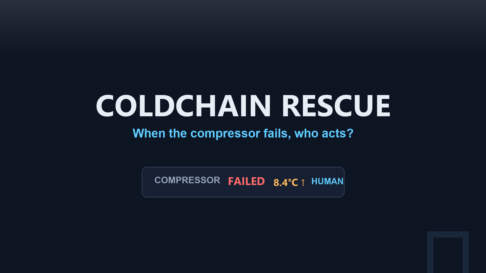
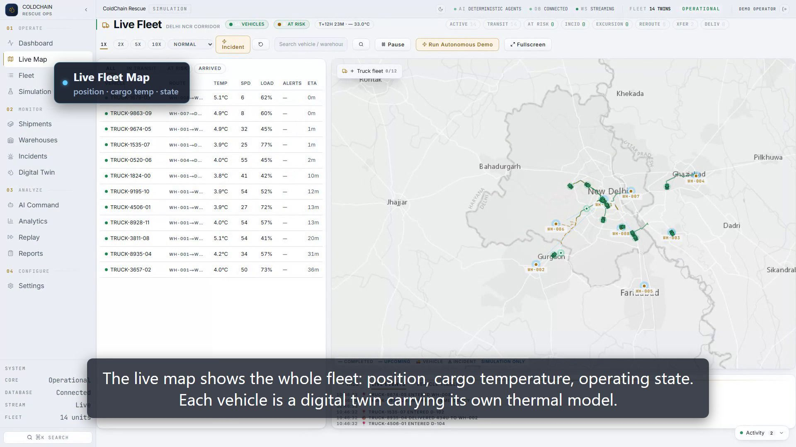
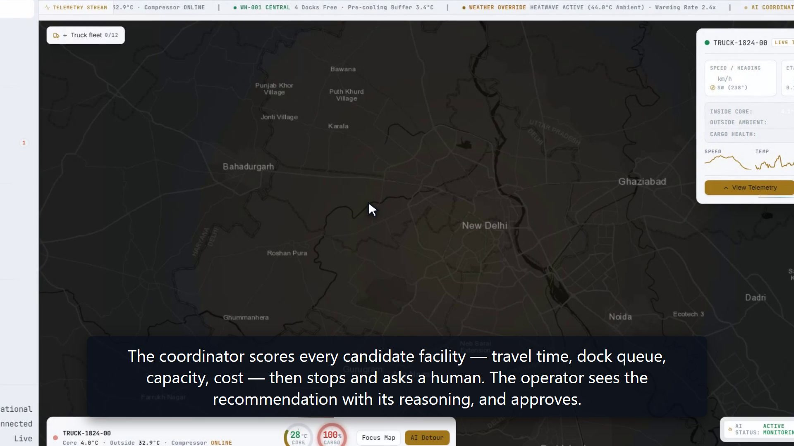
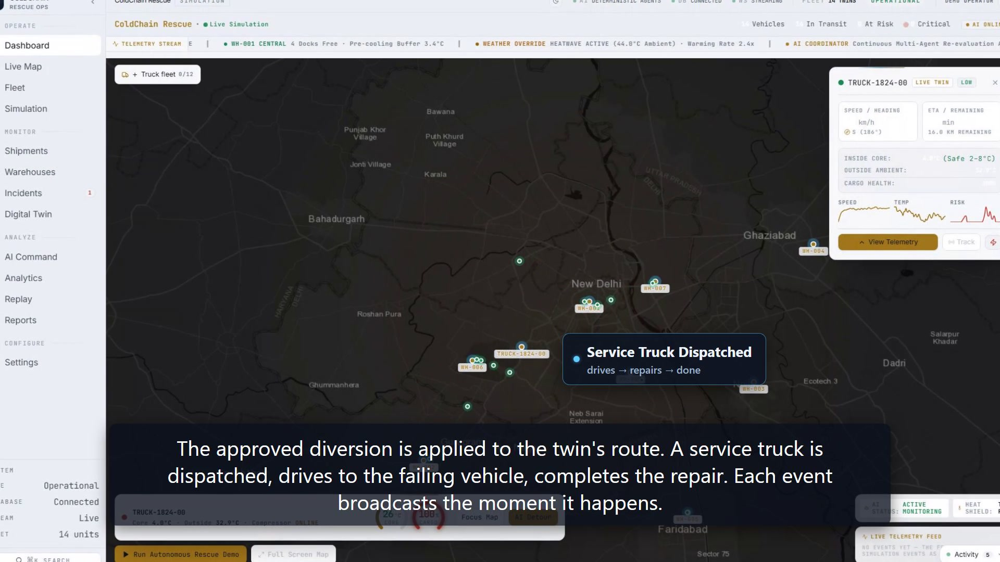

# ColdChain Rescue

**CBCA301 Capstone Project — Bennett University, BCA Semester V**

A live operational **digital twin for cold-chain logistics**: it detects
temperature excursions *while a vehicle is moving*, explains the cause, and
drives a verified recovery — rather than reporting the loss after delivery.



---

## 📹 Demo video (enhanced edition)

A narrated 3:42 walkthrough recorded from the running system: a compressor
failure is injected, the twin fails the truck live, the diagnosis agent scores
root causes, a human operator approves the diversion, a service truck executes
the repair, and recovery is verified against the cargo's temperature band —
with animated callouts, captions, and a full sound design.

[](docs/demo/final/ColdChain_Rescue_Demo_Enhanced.mp4)

**▶ [`docs/demo/final/ColdChain_Rescue_Demo_Enhanced.mp4`](docs/demo/final/ColdChain_Rescue_Demo_Enhanced.mp4)** — 1920×1080, 3:42, narration + captions

Chapters: `0:00` hook · `0:20` product · `0:40` live fleet map · `1:00` fault
injection · `1:20` diagnosis · `1:41` human approval · `2:05` execution ·
`2:22` verified recovery · `2:46` architecture · `3:11` test evidence

An earlier 2:03 walkthrough of every screen (no narration track edit) is at
[`docs/demo/coldchain-rescue-demo-narrated.mp4`](docs/demo/coldchain-rescue-demo-narrated.mp4).

Regenerate the enhanced cut with
[`docs/demo/final/enhanced/remotion-project`](docs/demo/final/enhanced/remotion-project)
(Remotion 4.0.535, `npx remotion render Demo`). The production report — what is
real footage vs. overlay, gate results, honest limitations — is
[`docs/demo/final/PRODUCTION_REPORT.md`](docs/demo/final/PRODUCTION_REPORT.md).

## ✨ Highlights

| | |
|---|---|
|  |  |
| **Live fleet map** — 14 vehicles, real-time telemetry | **Incident lifecycle** — injection → diagnosis → resolution |
|  |  |
| **Human approval gate** — autonomy proposes, never acts | **Verified recovery** — evidence before an incident closes |

## 📖 Full documentation

**[`docs/USER-GUIDE.md`](docs/USER-GUIDE.md)** — the complete guide: architecture
diagrams, run book, every screen explained, **every button and control**, the
six-agent decision loop, the Arrhenius derivation, a live-probed API
reference, design decisions and known limitations.

## 🏗️ Architecture diagram

```
┌──────────────────────────────────────────────────────────┐
│  FRONTEND — Next.js 15 · React 19 · Tailwind 4           │
│  17 routes · MapLibre GL basemap · WebSocket client       │
└─────────────┬──────────────────────┬─────────────────────┘
              │ REST (proxied)       │ WebSocket
              ▼                      ▼
┌──────────────────────────────────────────────────────────┐
│  BACKEND — FastAPI · 5,400+ LOC · 41 modules              │
│  ┌────────────┐ ┌────────────┐ ┌──────────────────────┐  │
│  │ SIMULATION │→│  AGENTS    │→│  ACTUATION           │  │
│  │ fleet      │ │ 6 agents   │ │ divert / dispatch /  │  │
│  │ traffic    │ │ DETERMINISTIC│ │ transfer             │  │
│  │ clock      │ │ no LLM     │ │ contention-aware     │  │
│  └────────────┘ └────────────┘ └──────────────────────┘  │
│         ▼                                                 │
│  KINETICS — Arrhenius k(T)=A·e^(−Ea/RT) → RSL            │
└──────────────────────────┬───────────────────────────────┘
                           ▼
┌──────────────────────────────────────────────────────────┐
│  SQLite (default) · 15 tables · 14 digital twins          │
└──────────────────────────────────────────────────────────┘
```

**More diagrams** — both self-contained HTML with inline SVG, open directly in
any browser:

| Diagram | File |
|---|---|
| Use-case (UML) — 5 actors, 12 use cases, 54 endpoints mapped | [`docs/use-case-diagram.html`](docs/use-case-diagram.html) |
| Data flow — Level 0 context, Level 1 processes/stores, incident sequence | [`docs/data-flow-diagram.html`](docs/data-flow-diagram.html) |

## Quick start

Two terminals. Backend first.

```powershell
# 1. Backend  (port 8000)
cd backend
$env:APP_ENV="development"     # permits an auto-generated dev JWT secret
$env:CORS_ORIGINS="http://localhost:3000,http://127.0.0.1:3000,http://localhost:3100,http://127.0.0.1:3100,http://localhost:8000"
./.venv/Scripts/python.exe -m uvicorn app.main:app --host 127.0.0.1 --port 8000
```

```powershell
# 2. Frontend (port 3000)
cd frontend
npm run dev
```

Then open <http://localhost:3000/live-map>.

> **Never run `npm run build` while `next dev` is serving** — it corrupts the
> shared `.next` directory. Use `npx tsc --noEmit` for type checks.
>
> If the dev server wedges (port open, page blank, `/_next/static/*` 404s):
> kill the process **first**, then delete `.next`, then restart.

## Verify everything

```powershell
python .loop/judge.py        # 6 goals + 3 boundaries. Exit 0 = releasable
python tools/rubric_audit.py # self-audit against the CBCA301 rubric
```

`rubric_audit.py` probes the repository for each rubric-scoped artefact and
reports what is present or missing. It is how the documentation claims in
`docs/` were verified — it reads the filesystem rather than asserting, so it
cannot report a fixed list of gaps.

---

## What it does

| Capability | Route |
|---|---|
| Live fleet map with moving vehicles and trails | `/live-map` |
| Operations dashboard | `/dashboard` |
| Incident lifecycle: detection → recovery → verified resolution, with replay | `/incidents` |
| KPI and incident analytics | `/analytics` |
| Scenario control: heatwave / rain / fog, failure injection | `/simulation` |
| Per-vehicle digital twin reconstruction | `/twin` |
| Deterministic decision explanations | `/copilot` |
| Reports, shipments, settings | `/reports` `/shipments` `/settings` |

## Architecture in one paragraph

Next.js 15 + React 19 + Tailwind 4 frontend. FastAPI + SQLAlchemy + SQLite
backend; a **15-module deterministic Python simulation** driving six
rule-based operational agents. **There is no LLM in the operational path** —
Google/Gemini keys are used only to generate design-reference images. The UI
reports `ai_mode = DETERMINISTIC-AGENTS` and the header is gated on that exact
string, so the product cannot claim an AI it does not use. This is deliberate:
the rubric scores *reproducible results*, which an LLM decision layer would
forfeit. Full detail in [`docs/ARCHITECTURE.md`](docs/ARCHITECTURE.md).

### Diagrams

| Diagram | File |
|---|---|
| Use-case (UML) — 5 actors, 12 use cases, 54 endpoints mapped | [`docs/use-case-diagram.html`](docs/use-case-diagram.html) |
| Data flow — Level 0 context, Level 1 processes/stores, incident sequence | [`docs/data-flow-diagram.html`](docs/data-flow-diagram.html) |

Both are self-contained HTML with inline SVG — open them directly in any
browser, no server or dependencies required.

## Documentation

| Document | Rubric item it serves |
|---|---|
| [`docs/USER-GUIDE.md`](docs/USER-GUIDE.md) | **Start here** — full usage guide, every control, architecture, API reference |
| [`DESIGN.md`](DESIGN.md) | **Design Contract ("OPS v2")** — tokens, typography, thermal spectrum, anti-slop rules |
| [`docs/LOG-DIARY.md`](docs/LOG-DIARY.md) | Milestone-2 — Documentation & Project Management (progress evidence, action plan, future prospects) |
| [`docs/ARCHITECTURE.md`](docs/ARCHITECTURE.md) | Milestone-2 — System/Technical Design |
| [`docs/TESTING.md`](docs/TESTING.md) | Milestone-2 — Testing & Validation |
| [`docs/PERFORMANCE-RESULTS.md`](docs/PERFORMANCE-RESULTS.md) | Milestone-2 — Performance & Results |
| [`docs/SDG-STAKEHOLDERS-REQUIREMENTS.md`](docs/SDG-STAKEHOLDERS-REQUIREMENTS.md) | Milestone-1 — SDG alignment, stakeholders, requirements |
| [`HANDOFF.md`](HANDOFF.md) | Project state and continuation notes |

## Quality gates

`.loop/judge.py` is a deterministic acceptance gate. It exists to stop an
automated agent (or a tired human) from declaring success without evidence.

| ID | Check |
|---|---|
| G1 | `tsc --noEmit` exits 0 (100% clean type check) |
| G2 | 5/5 backend suites independently exit 0 (143/143 tests passed) |
| G3 | Backend serves. `ai_mode` is exactly `DETERMINISTIC-AGENTS` |
| G4 | 17 routes: HTTP 200, exactly one `<h1>`, 0 console errors |
| G5 | Computed-style probes match a human-written baseline. Layout guards clean |
| G6 | No control renders under the 24px WCAG 2.5.8 hit area |
| B1 | 8 protected files byte-identical to baseline — **tests cannot be edited to make the gate pass** |
| B2 | No credential material in any tracked file |
| B3 | No `.env` tracked by git |

B1 is the anti-Goodhart control, and it was verified by deliberately corrupting
a test file: the judge reported `PROTECTED FILE MODIFIED`, `RELEASABLE: False`,
exit 1.

## Known limitations

Recorded rather than hidden — see `docs/ARCHITECTURE.md` §8 and
`docs/SDG-STAKEHOLDERS-REQUIREMENTS.md` §8.

- Simulation only — no real telematics hardware
- SQLite, single-node
- **Authentication:** fail-closed JWT auth now gates the API (Phase 1 of the
  security hardening — 138 tests, database-isolated). The JWT layer *refuses to
  start* outside development without an explicit secret. WebSocket telemetry
  uses single-use, short-lived tickets. Full detail in
  [`FINAL_ENGINEERING_AND_SECURITY_REPORT.md`](FINAL_ENGINEERING_AND_SECURITY_REPORT.md).
- `/live-map` still interpolates through the data layer (2,604 mutations/s)
- Arrhenius parameters are validated against **synthetic** ground truth
  generated from the same parameters (MAPE 0.10%) — proof the implementation is
  correct, *not* that the model predicts real spoilage. See
  `docs/USER-GUIDE.md` §7.

---

## 🔐 Credential security

Two Google/Vertex API keys were found hardcoded in tracked source and in git
history. Current status:

| Item | State |
|---|---|
| Rotated at the provider | ✅ Done — owner confirmed |
| Removed from source | ✅ `config.py` reads env vars only |
| Removed from **all git history** | ✅ 0 credential-shaped values across 443 blobs |
| `backend/.env` tracked | ❌ No — gitignored |
| `backend/.env.example` | ✅ Committable template, no real values |
| Working tree | ✅ Clean — verified by shape scan |

The rewrite used `git filter-repo` with a blob callback
([`tools/redact_blobs.py`](tools/redact_blobs.py)). Redaction rules are in
[`tools/redact_secrets.txt`](tools/redact_secrets.txt) and
[`tools/scan_history_secrets.py`](tools/scan_history_secrets.py) re-verifies the
whole history.

> Cleaned history is what this repository serves. `scan_history_secrets.py`
> re-verifies the whole history on demand.

## 🔒 Dependency posture

Next.js was upgraded 15.3.2 → **15.5.27** (patched for the Windows RCE and
AVIF advisories) and the full build + acceptance sweep re-verified — see
[`FINAL_ENGINEERING_AND_SECURITY_REPORT.md`](FINAL_ENGINEERING_AND_SECURITY_REPORT.md).
